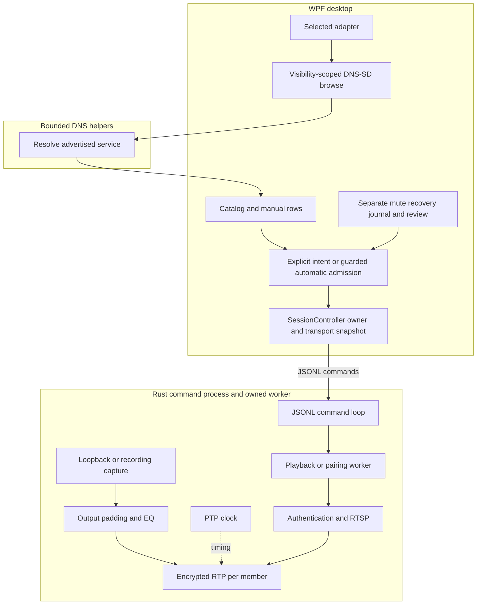

# AirFlash on the fork's main branch

## Current-source boundary — 2026-10-20

The subsystem maps below retain their audited historical source/base. Current original stable is `439de626` with schema 4, software stereo, per-receiver profiles/rates, application capture and password authentication. Consult the [current stable implementation and verification overlay](../issues/CURRENT-HEADLESS-IMPLEMENTATION-2026-10-20.md) and actual current source before applying older trace details. Fork runtime follows the reviewed current-base integration described there; its headless evidence does not qualify desktop or real-device behavior.

## Comprehensive recheck — 2026-10-18

The maps below retain their pinned historical source. [Current verification](../issues/COMPREHENSIVE-VERIFICATION-2026-10-18.md) traces all seventeen report contracts and public issue/PR state at runtime merge `a1182b0`. The [desktop shell](desktop-shell.md#shutdown-correction--2026-10-18) and [verification](verification.md#comprehensive-audit-supplement--2026-10-18) supplements record B's newly reproduced/repaired first-Quit-await admission gap and actual shared-path assertions. Browse lifetime prose distinguishes tracked calls/managed consumer sections from unobserved native return stacks. Other historical source/measurement limits remain explicit.

## Current source and verification

This map reviews fork **`main` at `06237873dcb6394eb35e97a017c536843bd7743d`**, on **2026-10-12**. Its desktop, native engine, scripts, installer, tests and workflow trees match runtime `8989b3609dd1294f4d1d6eb1502f345cc22bc382` and qualified code `4ae1db4f01dcf7857482dd136ea8d9dffa3aa8a1`. Documentation-only updates do not change that runtime baseline. Every original analysis file receives a new source review; three additional maps cover previously scattered shell, build and verification behavior.

Original stable `cf420d97700463c56adc31408510e8336e99e51c` is included. All eight groups, Settings scrolling and installer repairs are integrated in the fork. A and scrolling are also upstream; merged PR #19 supplies only part of B. B PR #15 remains closed without merge. C–H and the installer follow-up remain fork implementations.

Current source links pin `06237873`; historical sections retain the original `41190e0` audit and earlier evidence. [Upstream dev](upstream-dev.md) is excluded, not an implementation source. [Issue status and publication plan](../issues/README.md) separates integrated code from pending upstream actions. Completing the reported fixes does not mean the application has no remaining limitations; the source maps state those explicitly.

| Evidence | Actual scope and result |
| --- | --- |
| Local checks | `4ae1db4`: 667 Core tests in Debug and Release; Release build zero warnings/errors. Later `8989b36`: fresh Release 667, build zero warnings/errors, 124 Python tests and lint passed |
| [Exact reviewed-main CI](https://github.com/ThatMarko/AirFlash/actions/runs/38329156167) | `06237873`: 667 Core, 124 Python plus lint, 69 native passes with two ignored; native checks/build, discovery stability, bundle audit and packaged startup/compatibility succeeded |
| [Packaged integration](https://github.com/ThatMarko/AirFlash/actions/runs/38294493405) | `4ae1db4`: 69 native passes, recording-device qualification and the 30-minute localhost soak ignored; 667 Core; six full portable UI pairs of 1,059 assertions each; three observed 125% DPI cases of 40 each; disposable-runner MSI lifecycle |
| Earlier narrow checks | The 225 modal PIN assertions and six actual synthetic DNS-helper checks belong to their stated earlier source, not new executions on `8989b36` |
| Remaining limits | Real receiver reliability, acoustic/network measurements and physical power-loss durability are unqualified |

[Continuation acceptance](../issues/CONTINUATION-ACCEPTANCE.md) binds failures, controls and passes to their actual source/binary. [Audit](audit.md) records all-file source/document review; [verification](verification.md) explains exactly which layers run real code, fake services, shell integration or hosted packages. These references do not claim a new hardware run.

## Reading the subsystem maps

| Document | Current responsibility |
| --- | --- |
| [Discovery](discovery.md) | Visibility-scoped DNS-SD, selected interface, advertisement/cache TTL, logical deadlines and helper ownership |
| [After discovery](after-discovery.md) | Catalog reconciliation, active rows, manual routing and automatic admission after persistence |
| [Identity](identity.md) | Canonical ids, aliases and preferences; separate accessory credential identity |
| [Settings](settings.md) | Schema 2, migration, preservation, loaded validation, Apply and startup |
| [Desktop shell](desktop-shell.md) | Startup/readiness, tray, windows/dialogs, commands, themes, updates, autostart and shutdown ordering |
| [Session](session.md) | Atomic snapshot/owner/intent, serialized lifecycle changes, engine attempts and controls |
| [Engine](engine.md) | Command process/worker, authentication, RTSP, PTP, capture and RTP |
| [Equalizer](equalizer.md) | Filter/headroom preparation, preview ownership, sequence outcomes and adoption |
| [Authentication](auth.md) | ASCII PIN, transient setup, persistent pairing, pair-verify and credential errors |
| [Failures](failures.md) | Classification, IPC rejection, cleanup/retry, notices and pre-fault diagnostics |
| [Playback coupling](playback-coupling.md) | Catalog availability versus owned transport, with stale-work rejection |
| [Capture and clocks](capture-clocks.md) | Loopback/recording capture, output padding, underruns and clocks |
| [Control and mute](control-and-mute.md) | Exact-bit restore, journal/lease/review, RTSP serialization and PTP binding |
| [Credentials and IPC](credentials-and-ipc.md) | JSONL v1 limits/events and accessory-keyed DPAPI files |
| [Build and release](build-and-release.md) | Selected SDK, native/dependency policy, embedding, reservations, packaging, MSI and workflow boundaries |
| [Verification](verification.md) | Test architecture, scheduling/negative controls, diagnostic side effects, source/binary/CI provenance and unqualified behavior |
| [Source check](source-check.md) | Supported claims and limits of source/mocks |
| [Upstream dev](upstream-dev.md) | Excluded-development comparison |
| [Audit](audit.md) | Coverage, provenance, independent review and verification limits |

## Source directories and fork composition

| Source area | Owning maps and consumers |
| --- | --- |
| `desktop/AirFlash.Core` | Settings/store, catalog/identity/selection, serialized session, JSONL events, EQ, mute journal/lease, update policy; consumed by the WPF view models and Core tests |
| `desktop/AirFlash.App/ViewModels` | Catalog admission/reconciliation, drafts/Apply, endpoint and EQ preview, Monitor; [after discovery](after-discovery.md), [settings](settings.md), [session](session.md), [equalizer](equalizer.md) |
| `desktop/AirFlash.App/Services` | Audio MTA/backend, DNS browse/helper boundary, paths/engine extraction, tray/single instance/autostart/platform services; [discovery](discovery.md), [mute](control-and-mute.md), [shell](desktop-shell.md), [build](build-and-release.md) |
| App windows, `Ui`, resources and localization | Panel/Settings/PIN/recovery controls, popup geometry, themes/icons, bindings/dynamic text and scrolling; [shell](desktop-shell.md), [settings](settings.md), [auth](auth.md), [EQ](equalizer.md), [failures](failures.md) |
| `native/airflash-engine/src` | JSONL parser/control, worker, auth/DPAPI, RTSP, capture/resampling, EQ, clocks and RTP/feedback/retransmit/volume; [engine](engine.md) and its dedicated subsystem maps |
| App `Verification`, Core/native tests, root `tests` | Separate seams, harnesses and fixtures; [verification](verification.md), with regression assertions linked by each subsystem |
| `scripts`, `installer`, `.github/workflows`, manifests/locks | SDK/native builds, API compatibility audit, finite probes, reservation/release verification, WiX refresh/lifecycle and unofficial CI; [build](build-and-release.md), [verification](verification.md) |
| `docs/analysis`, `docs/issues` | Private fork source maps, implementation plans and acceptance evidence; intentionally excluded from public implementation branches |

Original stable `cf420d9` contributes inherited WPF/engine behavior and later upstream recording-capture/platform changes. The fork additionally integrates A–H, scrolling and installer fixes, with separate public feature histories and acceptance. A/scrolling are upstream; PR #19 overlaps only bounded B retention. The remaining fork behavior is not silently treated as upstream integration. Ordinary update checks still target the original repository's stable release, not this fork's unofficial package. See [build/release](build-and-release.md) before packaging and [upstream status](../issues/README.md) before publication.

## Two processes

The principal programs are the WPF desktop and Rust engine. They share no memory and expose no C-ABI; playback/pairing uses JSONL v1 over stdin/stdout. The desktop also starts bounded, short-lived DNS resolve helpers using its own executable. Helpers dispatch before WPF, platform logging or application-data initialization.

WPF owns discovery, rows, preferences and user intent. Rust owns authentication and transport. DNS availability does not prove pairing/playback readiness. Passive absence does not stop an owned Connecting, Pairing, Streaming or Standby attempt. Explicit Stop, cancellation, handshake failures and native terminal faults still govern it.

A reply, timeout or successful-looking cancellation does not prove child exit. Started helper ownership settles only after successfully observing the exact child exiting. Logical requests, cache state and process ownership are separate; see [Discovery](discovery.md).

## Startup and readiness

Production callers are [Program](https://github.com/ThatMarko/AirFlash/blob/06237873dcb6394eb35e97a017c536843bd7743d/desktop/AirFlash.App/Program.cs), [App startup](https://github.com/ThatMarko/AirFlash/blob/06237873dcb6394eb35e97a017c536843bd7743d/desktop/AirFlash.App/App.xaml.cs) and [AppViewModel](https://github.com/ThatMarko/AirFlash/blob/06237873dcb6394eb35e97a017c536843bd7743d/desktop/AirFlash.App/ViewModels/AppViewModel.cs).

1. Helper modes return before normal desktop initialization. Supported diagnostics select isolated output/data before logging and WPF; ordinary startup keeps its normal data location. Engine extraction still uses the normal SHA-keyed local engine cache, independently of diagnostic data isolation.
2. Normal startup checks the Windows baseline and initializes WPF/localization. The single-instance owner continues; another instance signals it and exits.
3. One stateful `SettingsStore` loads for theme/language and again in the view model. Preservation obligations survive both reads. Startup constructs audio, deferred engine readiness, discovery, view model, panel and tray.
4. The shell starts asynchronous view-model initialization and displays the panel unless `--startup` was passed. Engine initialization is awaited after shell readiness. Its failure leaves the shell available with diagnostics/retry; new starts require readiness.
5. View-model initialization handles mute recovery before app settings/lifecycle locks, then load warnings, default endpoint, autostart and endpoint migration. Audio operations use the service's MTA thread and surface failures.
6. Discovery demand comes from panel visibility, Receivers-page visibility or the ten-second startup window when automatic connection is configured. Otherwise browsing pauses. A selected missing/offline adapter pauses without an all-interface fallback.

Current startup does not guarantee an empty first publication: retained cache/advertisement state and asynchronous results determine it. Availability is not authority to cancel a newer session.

## Five stages

1. **Discover.** Browse `_airplay._tcp.local` and `_raop._tcp.local` on the chosen IPv4 interface. Resolve advertised names to IPv4/port/TXT with TTL-based expiry, deadlines/backoff and bounded owners.
2. **Identify.** Aggregate advertisements and confirmed stereo relationships. Reconcile aliases/settings. Manual rows persist independently and keep explicit host/port/options.
3. **Admit.** Play/Pair/Stop and view-model disposal invalidate older automatic intent before their controller waits. Shell Quit reaches that disposal after earlier Settings/engine-initialization waits; [desktop shell](desktop-shell.md) records this source-derived window. Automatic work captures controller authority before persistence, then revalidates canonical candidate/options/online/completeness/visibility under the settings gate and serialized admission. Only admitted attempts update attempted/last-used state.
4. **Connect.** Resolve members to IPv4 and launch the engine. New stereo attempts require completeness. Pairing uses its PIN flow and exclusive authentication method. Delayed retargeting must retain desktop owner/intent even if a row id is reused.
5. **Retain and clean up.** Passive loss keeps the owned transport and controls. Compatible identity promotion can update it under guards. Explicit Stop and terminal faults still clean up. Retries create a new process, session UUID, PTP clock and SSRCs rather than resuming RTP.

Attempted candidates are filtered before ranking. An attempted preferred row does not block an eligible unattempted row. `Error` remains an inactive state eligible for admitted automatic work.

## What crosses the process boundary

[SessionController](https://github.com/ThatMarko/AirFlash/blob/06237873dcb6394eb35e97a017c536843bd7743d/desktop/AirFlash.Core/SessionController.cs) sends member IPv4/port/codec information, capture endpoint, latency, output sample rate, master gain and EQ. Catalog/display identities are not credential keys. Native endpoint direction determines recording input versus playback loopback flags.

The desktop uses `source: loopback`, `timing: ptp` and unbounded normal playback duration; a selected recording endpoint is handled by its actual native direction. Master gain derives from master volume and panel mute, not the saved per-row volume field.

Protocol version remains 1. Native stdin byte accounting includes the newline and differs from desktop stdout validation. The exact defined empty-correlated terminal IPC rejection is recognized before ordinary session filtering, with original detail and nonretryable classification. During Pair's awaited PIN prompt, the sole event reader pauses, so processing can wait until the prompt resumes; cancellation/timeout may win. Ordinary stale events remain filtered; nonfatal EQ rejection remains nonfatal. See [Credentials and IPC](credentials-and-ipc.md).

Credentials use current-user DPAPI and accessory `/info deviceID`. Catalog alias/manual identity changes do not migrate files. Genuine initial credential-file absence permits transient authentication; storage/decrypt/parse/verification errors remain errors. The inherited missing/empty `deviceID` path is separately bounded in [Authentication](auth.md).

The separate mute journal records actual endpoint identity, exact prior bit and exclusive ownership before mutation. Pending/ambiguous recovery requires conservative review. Normal restoration remains best effort; actual recording endpoints receive no mute read/write.

## Defaults that shape the workflow

| Setting | Default | Meaning |
| --- | --- | --- |
| Discovery interface | All interfaces | Explicit unavailable selection pauses without fallback |
| Auto-connect | Off | New automatic starts require an enabled eligible candidate |
| Force reconnect | Off | Enabled retries still require a retryable fault |
| Reconnect attempts | 5 | Range 1–20 |
| Mute while streaming | On | Admission with muting enabled requires recovery readiness; recording endpoints are excluded from mute access |
| Latency | `normal`, 200 ms | Realtime 120 ms; buffered 500 ms; custom 0–2000 ms |
| Output sample rate | 44100 | Also 48000 |
| Standby | Off | Configured local silence changes the label; the stream continues |

Defaults come from [AppSettings](https://github.com/ThatMarko/AirFlash/blob/06237873dcb6394eb35e97a017c536843bd7743d/desktop/AirFlash.Core/Settings.cs); normalization/validation is in [Settings](settings.md).

## Scope of one session

One attempt owns a receiver or complete stereo transport snapshot. Native peers share capture pulls, RTP timestamp origin and PTP clock; per-peer RTSP, sequence/SSRC/keys and watches remain separate. A fatal member fault ends the group's worker. The command loop has a distinct lifetime and may remain alive after that worker stops.

Output-padding counters count local substituted output-rate slots before EQ, once per shared pull; fully padded packets count wholly missing 352-frame pulls. Captured silence, zero gain and EQ tails do not redefine padding. These counters and successful UDP sends do not establish network/acoustic behavior.

Attempts reset live counters. Absent/invalid optional metrics remain unavailable, while pre-fault snapshots survive cleanup/retry. Monitor's localized copy action reuses the existing serializer/error surface.

## Historical audit boundary

The original audit described upstream runtime `41190e0d13a63a714c08dffe73ababca1804875c`, with documentation baseline `c077a05`. At that source, passive discovery Stop, stale automatic Toggle, unguarded settings recovery, Boolean credential probing, misleading EQ results and in-memory-only mute ownership were source-supported defects/gaps. Current reports describe their implemented, bounded resolutions.

The October 10 private integration and pending-reboot statements were earlier snapshots. Reboot and subsequent verification are complete. Original source and executed failures remain pinned in Git and [acceptance records](../issues/CONTINUATION-ACCEPTANCE.md), without relabeling them as fresh Main executions. All 17 reports are implemented; upstream publication, hardware qualification and release actions remain separate work.
