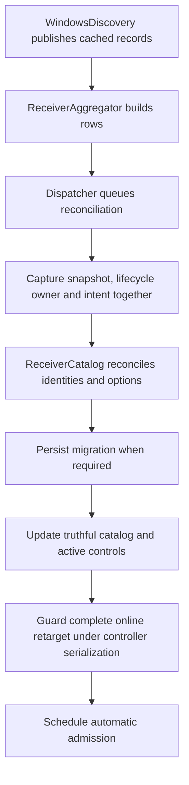

# After discovery: catalog, session updates, and auto-connect

## Current-source boundary — 2026-10-21

Current original stable is `439de626`; combined `6c1e2ef` retains its software stereo and scoped discovery. Atomic admission/retarget guards remain candidate work. Canonical identity persistence is separate from an owned transport: current flush/Apply/endpoint callers capture a frozen settings context under the app gate and project it only after serialized owner/intent checks. Ordinary saves preserve owned effective options and software members; explicit changes follow their own admission path. See [current session/settings behavior](session.md).

[Current source, acceptance and executed limits](../issues/PR-READINESS-2026-10-21.md) supersede older current/open/schema labels below. The remaining source links and test counts retain their recorded historical baselines; this documentation refresh claims no new test execution or upstream publication.

## Discovery preparation supplement — 2026-10-13

Current fork code `c5ddb894e8bf0f977a94920ff26878c3cf5e1004` integrates standalone D `b8ee79511e2fa41ee02651dad83d50e008f9f680`, based on original `cf420d97700463c56adc31408510e8336e99e51c`. Every changed valid current record/TXT refresh now requests catalog publication; gpn/igl/pk/cn no longer silently wait for unrelated publication. The older description-only notification statement below is pinned0623787 behavior. Reconciliation/settings gates/controller authority and manual persistence are unchanged. Helper TXT case-insensitive keys preserve identity/stereo/codec input to aggregation.

[D acceptance](../issues/GROUP-D-ACCEPTANCE.md) records source, tests, reviews and limits. The earlier source map below retains its pinned historical baseline.

This page describes fork `main` at **`06237873dcb6394eb35e97a017c536843bd7743d`**, reviewed on 2026-10-12. Original stable `cf420d97700463c56adc31408510e8336e99e51c` is already included. All Group B changes are pushed and integrated in this main; their upstream publication status remains separate. [Audit](audit.md) and [current acceptance](../issues/CONTINUATION-ACCEPTANCE.md) define the source and verification boundaries.

A publication aggregates service records on the discovery publisher's thread and queues reconciliation on the WPF dispatcher. Resolve's publication trigger compares only its description fields, so a gpn/igl/pk/cn-only cached refresh can await a later publication before reaching this pipeline. Reconciliation takes the asynchronous settings gate; ordinary persistence can yield the dispatcher while Settings Pair and worker events proceed. Controller serialization supplies the final session authority check. Startup's engine `hello` is a separate initialization operation, not a playback start. Discovery demand, notification limits and DNS operation ownership are described in [Discovery](discovery.md).

## Merging advertisements

[ReceiverAggregator.Build](https://github.com/ThatMarko/AirFlash/blob/06237873dcb6394eb35e97a017c536843bd7743d/desktop/AirFlash.Core/Receiver.cs) orders AirPlay first, then instance, address and port. It merges equal normalized identities even when model, stereo id or public key conflicts. That is catalog grouping, not authentication.

Shared `address:port` records merge only when exactly one existing group is compatible: nonempty `model`, `tsid` and `pk` must not disagree. Model comparison ignores case; stereo id and public key are ordinal. Multiple compatible candidates prevent the endpoint merge. An incompatible candidate logs a conflict but does not veto a unique compatible candidate. A later record may bridge one identity group and one compatible endpoint group; this remains a single-pass algorithm rather than unrestricted graph closure.

A physical row uses normalized device identity, otherwise an endpoint fallback. Distinct unidentified services sharing an endpoint receive distinct `endpoint:{host:port}#{hash}` ids. AirPlay-first ordering determines the display address/name; codecs come from RAOP `cn`. Merge diagnostics are logged only when absent from the immediately preceding diagnostic set; a disappearing and returning message can be logged again.

### Stereo rows

Devices with `tsid` group into `stereo:{tsid}`, leader first then member id. A group is complete only with exactly two members. Its name uses `gpn` or the leader name; member aliases/options remain on members while the group has separate options. A leader change can change the group's transport signature without changing its group id.

A one-member or overfull group remains an incomplete catalog row. New playback/pairing requires completeness. An already owned complete session retains its original transport through partial/offline data. Selecting a manual row keeps its endpoint, port, identity and options. Selecting a group keeps that group. An individual discovered member can redirect only to a unique online canonical/broadcast-alias owner; there is no address-only or address-plus-port fallback. Ambiguity rejects before an engine command. See [Identity](identity.md) and [ReceiverSelection](https://github.com/ThatMarko/AirFlash/blob/06237873dcb6394eb35e97a017c536843bd7743d/desktop/AirFlash.Core/ReceiverSelection.cs).

## Stable identity

[ReceiverCatalog.Reconcile](https://github.com/ThatMarko/AirFlash/blob/06237873dcb6394eb35e97a017c536843bd7743d/desktop/AirFlash.Core/ReceiverCatalog.cs) clones settings, canonicalizes physical identities and returns migrations without I/O. Manual ids never migrate. Only unique currently advertised endpoints may migrate endpoint preferences; durable `ReceiverAliases` contains broadcast identities, not endpoint associations.

Hidden options OR-merge; explicit automatic false wins; other nullable options use active-id, last-used-id and ordinal priority. Last-used follows valid migration. An identity backup is requested only when an existing preference key or last-used id moved, not for a new self-alias alone. [Settings](settings.md) describes exact-byte recovery and the separate identity backup.

[AppViewModel.ReconcileDiscoveryAsync](https://github.com/ThatMarko/AirFlash/blob/06237873dcb6394eb35e97a017c536843bd7743d/desktop/AirFlash.App/ViewModels/AppViewModel.cs#L301) captures snapshot, owner and intent before saving. A save failure exits before this transaction replaces its catalog or retargets its session; unrelated worker events can still happen. A successful save merges concurrent panel edits rather than discarding them. Draft Settings receives migrations in both draft and baseline, preserving unrelated unsaved edits.

After persistence, a fresh capture must retain the original owner and intent. Only a complete online discovered replacement reaches `TryUpdateReceiverAsync`, which rechecks authority under controller serialization. Metrics and native retries retain desktop ownership; same-id replacement changes it. Valid same-owner promotion remains possible, including Pairing metadata without a pairing restart. Signature changes retain their applicable playback restart. A newer Pair/Play/Stop prevents stale discovery work from controlling its worker, settings or diagnostics.

## The known-device map

Reconciliation replaces discovered rows, removes migrated-away ids and covered online members, and migrates attempted ids. Missing non-manual rows become offline with all interfaces selected, or leave the map with a selected adapter. Saved preferences persist in either case. A new row, prior offline row, or incomplete-to-complete transition can clear that id's attempt mark; identical online/complete publications do not reset it. Manual rows are reinserted from settings and remain independent of discovery.

`AllReceivers` includes hidden/offline catalog rows. Full equality includes aliases, codecs and members; reconciliation raises `CatalogChanged` only when that catalog changes. Engine-readiness and mute-recovery changes also raise it so Settings refreshes Pair enablement, even when the rows are unchanged. Settings builds from that full catalog and may synthesize saved offline history with its draft's all-interface choice. The applied interface controls actual browsing.

[RefreshReceivers](https://github.com/ThatMarko/AirFlash/blob/06237873dcb6394eb35e97a017c536843bd7743d/desktop/AirFlash.App/ViewModels/AppViewModel.cs#L371) ordinarily displays online, non-hidden rows, ordered by current-culture name. It also overlays an owned active row excluded by those filters. The overlay may use an offline/incomplete catalog row for truthful availability, but `Session.Snapshot.Receiver` retains the complete owned transport. `ReceiverViewModel.Active` keeps Stop enabled even when new Play is unavailable. Once ownership ends, a card retained only for that ownership disappears.

| Condition | Panel/control outcome |
| --- | --- |
| Inactive online complete non-hidden row | Play available when engine initialization and mute recovery permit it |
| Inactive incomplete group | Waiting for the other member; no new Play |
| Inactive offline or hidden row | Ordinary panel row filtered; settings/preferences can remain |
| Active Connecting/Pairing/Streaming/Standby | Retained control; toggle means Stop, including offline/incomplete/hidden availability |

The empty-panel title follows actual browse/search demand and its ten-second search timer; it is not universally “Searching” whenever no rows are visible. A paused selected adapter remains a pause and never becomes all-interface browsing.

## A session that is already playing

Passive empty, partial, repeated or unavailable discovery does not call Stop. Adapter browse restart likewise retains the owned attempt. Explicit Stop, PIN cancellation, shutdown and terminal native/capture faults govern termination and cleanup. The session can still restart on a guarded complete online update whose peer address/port/group leader flags, effective capture endpoint, effective latency or sample rate changed. Codec/name/model-only changes do not change that signature; the running engine keeps its last-start codec list.

Manual sessions are not retargeted from discovery. Settings and default-loopback endpoint notifications can still trigger their applicable owned restart. [Playback coupling](playback-coupling.md) distinguishes availability from transport, while [Session](session.md) describes fresh-process retries and cleanup.

## The auto-connect timer

Every accepted discovery reconciliation restarts the 900 ms automatic timer. [SelectAutoConnect](https://github.com/ThatMarko/AirFlash/blob/06237873dcb6394eb35e97a017c536843bd7743d/desktop/AirFlash.Core/ReceiverSelection.cs#L25) filters online, complete, non-hidden, opted-in **unattempted** candidates before last-used/name/id ranking. Per-receiver false overrides global true; a true override permits admission with global automatic connection off. Automatic connection defaults off.

[TryAutoConnectAsync](https://github.com/ThatMarko/AirFlash/blob/06237873dcb6394eb35e97a017c536843bd7743d/desktop/AirFlash.App/ViewModels/AppViewModel.cs#L488) captures authority before awaited persistence. Afterward, under the settings gate, it resolves the current canonical candidate and rechecks availability, visibility, current options, attempts, readiness, suppression and closing. The gate remains held through `TryStartAutomaticAsync`; controller serialization requires the original owner/intent and inactivity, including eligible Error. Authority is rechecked after old-worker cleanup.

Automatic admission is separate from click Toggle. Play, Pair and Stop invalidate older intent synchronously before their awaits; view-model disposal does so at its entry. The shell's initial Quit request first awaits any Settings transaction and engine-probe disposal, so that earlier interval is not an admission barrier; see [desktop shutdown](desktop-shell.md#shutdown-and-failure-boundaries). Pair does not wait behind the settings gate or hold that gate across a PIN prompt. Stale rejection at the initial serialized authority/inactive check does not enter worker cleanup. If that check passes but intent/recovery changes while StartLocked awaits older-worker cleanup, a later rejection may finish that old cleanup, including its Stop request, and publish Idle; it sends no new Start and cannot control a newer owner. Rejected work does not mark an attempt or last-used and cannot clear newer Stop suppression. Valid persistence still completes. An admitted attempt updates attempted/last-used even if its subsequent connection fails. Multiple queued automatic requests admit at most one eligible current lifecycle. Turning global auto-connect on clears suppression and attempt marks as the intended reset.

## Source and verification scope

Current [SessionLifecycleTests](https://github.com/ThatMarko/AirFlash/blob/06237873dcb6394eb35e97a017c536843bd7743d/desktop/AirFlash.Tests/SessionLifecycleTests.cs), [ReceiverSelectionTests](https://github.com/ThatMarko/AirFlash/blob/06237873dcb6394eb35e97a017c536843bd7743d/desktop/AirFlash.Tests/ReceiverSelectionTests.cs), [ReceiverIdentityTests](https://github.com/ThatMarko/AirFlash/blob/06237873dcb6394eb35e97a017c536843bd7743d/desktop/AirFlash.Tests/ReceiverIdentityTests.cs), and separate WPF [UiSessionLifecycle](https://github.com/ThatMarko/AirFlash/blob/06237873dcb6394eb35e97a017c536843bd7743d/desktop/AirFlash.App/Verification/UiSessionLifecycle.cs) cover caller races, save failure, metrics during delay, same-id replacement, manual command targets, automatic fallback, all retained states and accessible Stop without assuming access through a modal PIN dialog. Core does not reference WPF; UI coverage comes from the separate fake-service harness.

Current main's 667 Core/124 Python and hosted native checks, plus the code-identical packaged six 1,059-assertion regional/catalog runs, are recorded in [current acceptance](../issues/CONTINUATION-ACCEPTANCE.md). This document update performs source/evidence review, not fresh playback or hardware qualification.

## Historical baseline and implementation

At [original `41190e0`](https://github.com/Ding-Kyoma/AirFlash/blob/41190e0d13a63a714c08dffe73ababca1804875c/desktop/AirFlash.App/ViewModels/AppViewModel.cs#L166), missing/incomplete discovery called unconditional Stop after an awaited save; automatic connection reused Toggle with pre-await-only admission and post-ranking attempted filtering; manual selection redirected by shared address. Those are historical defects documented by reports 01/02/03/10/11 and decisive fake baseline failures in [B acceptance](../issues/GROUP-B-ACCEPTANCE.md).

Original stable `cf420d9` includes [PR #19](https://github.com/Ding-Kyoma/AirFlash/pull/19)'s passive retention/fresh snapshot/Pairing exclusions. It does not supply the full atomic ownership/admission/manual-selection contract. Fork B `442e8d8` is integrated in current main; old [PR #15](https://github.com/Ding-Kyoma/AirFlash/pull/15) remains closed at its older snapshot. Earlier 437/666-test compositions and the Oct10 pre-reboot source-only audit retain their own evidence dates in acceptance records; they are not current status.

## Earlier Group B implementation (through 9e894ab)

The initial/follow-up branch observations are retained in [Group B acceptance](../issues/GROUP-B-ACCEPTANCE.md) and [historical combined acceptance](../issues/ABCD-INTEGRATION-ACCEPTANCE.md). This historical heading is kept for existing links; current behavior is the production narrative above.
