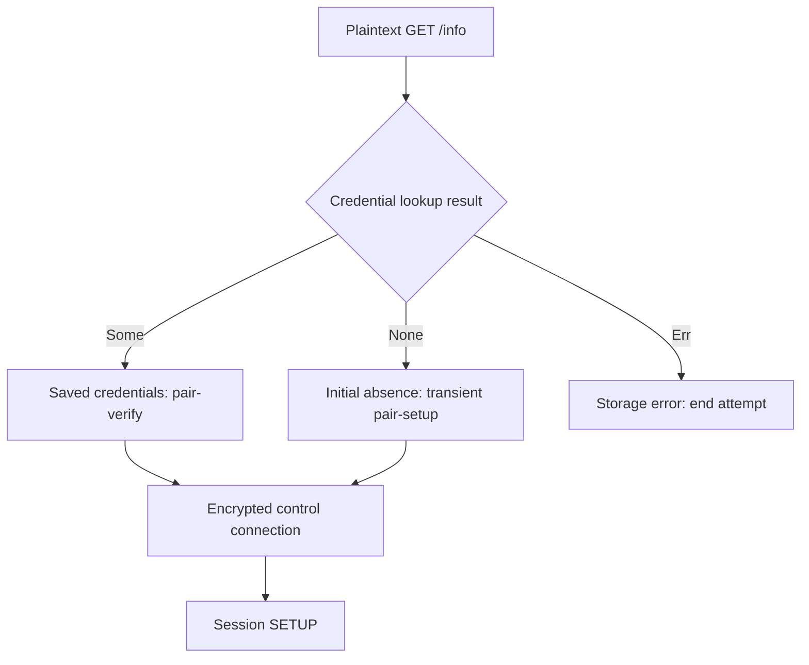

# Authentication

Source reviewed on 2026-10-12 at own-fork `main` `06237873dcb6394eb35e97a017c536843bd7743d`, containing original stable `cf420d97700463c56adc31408510e8336e99e51c`. This page describes that integrated fork source, not an unmerged feature checkout or original upstream runtime.

Playback still chooses one authentication method per connection. Group E makes the earlier credential lookup preserve errors and makes the PIN dialog submit the same normalized representation that it validates. It does not change the HAP pairing protocol, current-user DPAPI or accessory identity checks. E is integrated into this fork's main and remains separate from original stable publication.

## Playback admission and identity

Each member connects to its supplied TCP port (default 7000), reads plaintext `GET /info`, then uses a nonempty string `deviceID` for credential lookup. [Member::connect](https://github.com/ThatMarko/AirFlash/blob/06237873dcb6394eb35e97a017c536843bd7743d/native/airflash-engine/src/session.rs#L237) passes the result to [authenticate_with](https://github.com/ThatMarko/AirFlash/blob/06237873dcb6394eb35e97a017c536843bd7743d/native/airflash-engine/src/session.rs#L200): loaded credentials select pair-verify once; initial file absence selects transient setup once; a lookup/read/decrypt/parse error aborts before either exchange. A verification failure never tries transient setup on that connection.

The existing missing, non-string or empty playback `deviceID` path supplies `Ok(None)` without file lookup and therefore selects transient setup. That path is unchanged and outside the file-error classification fix. Persistent Pair requires a string `deviceID`, but still does not reject an empty string before saving. The filename key comes from `/info`, not a manual/catalog row or the authenticated HAP identity returned by M6. See [Credentials and IPC](credentials-and-ipc.md).

## Shared SRP prefix

[srp_handshake_prompt](https://github.com/ThatMarko/AirFlash/blob/06237873dcb6394eb35e97a017c536843bd7743d/native/airflash-engine/src/auth.rs#L96) implements both setup paths:

1. Empty `POST /pair-pin-start`; transient sends `X-Apple-HKP: 4`, persistent sends `3`.
2. `POST /pair-setup` state 1; transient includes TLV `0x13 = 0x10`.
3. Require state 2, request/validate the PIN, then require the salt and server public key.
4. Require 4–8 ASCII digits; salt is nonempty and at most 64 bytes, server public value nonempty and at most 384 bytes/nonzero modulo the prime, scrambling parameter nonzero.
5. Send state 3 client public/proof; require state 4 and a constant-time-matching server proof.

The code uses the 3072-bit SRP group, generator 5, SHA-512 and username `Pair-Setup`. Transient uses fixed PIN `3939`, enables control encryption from the SRP key and writes no credential. The next absent-credential start repeats the exchange.

Messages use TLV8 with octet-stream bodies. Repeated tags concatenate, truncated fields fail, and TLV tag 7 means rejection. `/pair-` paths use HTTP rather than RTSP. ChaCha20-Poly1305 identity messages put their eight-byte nonce label in the last eight bytes of a twelve-byte nonce. These are verified repository wire choices, not imported protocol behavior. [TLV/identity framing](https://github.com/ThatMarko/AirFlash/blob/06237873dcb6394eb35e97a017c536843bd7743d/native/airflash-engine/src/crypto.rs#L67) and [request framing](https://github.com/ThatMarko/AirFlash/blob/06237873dcb6394eb35e97a017c536843bd7743d/native/airflash-engine/src/rtsp.rs#L278) own them.

## Persistent setup, the Pair button

[pair_prompt](https://github.com/ThatMarko/AirFlash/blob/06237873dcb6394eb35e97a017c536843bd7743d/native/airflash-engine/src/auth.rs#L163) completes SRP, generates a new Ed25519 controller key and UUID, and signs derived controller-sign bytes plus controller id/public key. Those derived bytes are signed-message content, not the Ed25519 signing key. It seals M5 with `PS-Msg05`, requires M6, opens `PS-Msg06` and verifies the accessory signature.

The returned credential holds accessory id/public key and controller id/secret. Pairing does not compare M6 accessory id with the `/info` filename key. [the Pair worker](https://github.com/ThatMarko/AirFlash/blob/06237873dcb6394eb35e97a017c536843bd7743d/native/airflash-engine/src/main.rs#L288) saves current-user DPAPI credentials only after that authenticated exchange, emits `paired`, and leaves the command loop alive. It does not enable playback control encryption, send SETUP or bind PTP/NTP. Desktop cleanup disposes the pairing process; a later playback process uses pair-verify.

[PairMembersAsync](https://github.com/ThatMarko/AirFlash/blob/06237873dcb6394eb35e97a017c536843bd7743d/desktop/AirFlash.Core/SessionController.cs#L561) pairs members leader first, one process per member. Successful completion of all members proceeds to playback in a fresh process. Blank/cancelled dialog results publish Idle and prevent playback. The desktop PIN token and native channel wait are each 120 seconds; native cancellation is polled every 100 ms. Token timeout can publish Error rather than the blank-result Idle path.

Persistent stereo pairing is not one credential transaction. Each native member worker saves before emitting `paired`; if the next member fails or is cancelled, the earlier saved credential remains. Successful pairing followed by playback failure also leaves the credential available for the next attempt. Desktop does not roll those files back.

The controller awaits the PIN callback inside its sole pairing event-reader loop. While the modal dialog is open, it does not concurrently read a later native error or pipe EOF. A queued error can be processed when PIN handling resumes, but cancellation/timeout can win first. [Process rejection fixtures](https://github.com/ThatMarko/AirFlash/blob/06237873dcb6394eb35e97a017c536843bd7743d/desktop/AirFlash.Tests/IpcFailureTests.cs#L21) cover Pair before a PIN request, not prompt-open fault delivery; the dialog fixtures cover submission and cancellation separately. Error-preserving routing does not establish immediate fault display through an open PIN dialog.

## PIN representation

[PairingPin.Normalize](https://github.com/ThatMarko/AirFlash/blob/06237873dcb6394eb35e97a017c536843bd7743d/desktop/AirFlash.Core/PairingPin.cs#L3) rejects inputs longer than 16 characters or containing anything except ASCII digits and ASCII `-`, removes dashes, then requires 4–8 digits. [PinDialog](https://github.com/ThatMarko/AirFlash/blob/06237873dcb6394eb35e97a017c536843bd7743d/desktop/AirFlash.App/Ui/PinDialog.cs#L10) uses it for Pair enablement and the returned value. Thus synthetic `12-34` submits `1234`; whitespace, Unicode digits/dashes, letters and out-of-range lengths cannot submit.

Typing filters characters; pasted textbox content still passes the same enable/submission check. The single-line WPF box can truncate at a newline first: a clipboard value ending `1234` plus newline becomes textbox `1234` and validly submits that prefix. This is tested separately from direct invalid-text assignment. [pair_pin submission](https://github.com/ThatMarko/AirFlash/blob/06237873dcb6394eb35e97a017c536843bd7743d/desktop/AirFlash.Core/SessionController.cs#L579) forwards the normalized dialog value. Native [strict PIN validation](https://github.com/ThatMarko/AirFlash/blob/06237873dcb6394eb35e97a017c536843bd7743d/native/airflash-engine/src/auth.rs#L113) remains unchanged. A formatted all-digit PIN being accepted locally does not prove that a real receiver accepts it.

## Pair-verify, on start with a file

[verify](https://github.com/ThatMarko/AirFlash/blob/06237873dcb6394eb35e97a017c536843bd7743d/native/airflash-engine/src/auth.rs#L237) sends a fresh X25519 public key with `X-Apple-HKP: 3`, requires state 2 and a contributory peer key, derives the shared secret, and opens `PV-Msg02`. It requires the accessory id to equal the saved id and verifies its Ed25519 signature over peer public/id/our public. It signs our public/controller id/peer public with the saved secret, seals `PV-Msg03` and requires state 4.

Control keys use HKDF-SHA512 `Control-Salt` with `Control-Write-Encryption-Key` and `Control-Read-Encryption-Key`; this path derives them from X25519, transient from SRP. Later events/audio derivations are in [Engine](engine.md). Receive tag errors end authentication/transport; write failure additionally poisons subsequent socket writes.

## Failures

Authentication protocol/crypto errors map generic `protocol_error` to final `authentication_failed`. Transport closure/timeouts within authentication keep their transport code and may retry. Credential storage errors occur before that wrapper: the outer member setup wrapper can report `protocol_error` (final) or I/O `socket_error` (retryable). Error preservation is not a promise that every credential error has an authentication code. [authentication selection](https://github.com/ThatMarko/AirFlash/blob/06237873dcb6394eb35e97a017c536843bd7743d/native/airflash-engine/src/session.rs#L200) and [Fault classification](https://github.com/ThatMarko/AirFlash/blob/06237873dcb6394eb35e97a017c536843bd7743d/native/airflash-engine/src/transport.rs#L63) establish this distinction.

Desktop playback honors explicit retryability. Pairing stops on failure and has no playback retry loop; raw PIN errors can use the generic worker fallback rather than an authentication code. No failed stored verification switches methods.

## Source verification and coverage

Current [PIN tests](https://github.com/ThatMarko/AirFlash/blob/06237873dcb6394eb35e97a017c536843bd7743d/desktop/AirFlash.Tests/PairingPinTests.cs#L27), [loader fault fixtures](https://github.com/ThatMarko/AirFlash/blob/06237873dcb6394eb35e97a017c536843bd7743d/native/airflash-engine/src/credentials.rs#L203), [authentication selection fixtures](https://github.com/ThatMarko/AirFlash/blob/06237873dcb6394eb35e97a017c536843bd7743d/native/airflash-engine/src/session.rs#L793), [synthetic persistent/verify tests](https://github.com/ThatMarko/AirFlash/blob/06237873dcb6394eb35e97a017c536843bd7743d/native/airflash-engine/src/auth.rs#L438) and the WPF pairing harness cover boundaries, actual fake `pair_pin` payloads, cancellation, temporary-root DPAPI and exactly-one-method/error paths. [Group E acceptance](../issues/GROUP-E-ACCEPTANCE.md) preserves the separately executed earlier 225-modal-check run and failing error-hiding control; those earlier results are not relabelled as a new run at main.

Executed suite/package evidence is centralized in [Verification](verification.md): [exact `0623787` normal CI](https://github.com/ThatMarko/AirFlash/actions/runs/38329156167) and the separate full package run at code-identical `4ae1db4`. Subsystem/group acceptance records retain earlier controls and source-specific results. This deeper review inspected source and regression assertions; it did not rerun suites or hardware checks.

## Historical audit

At original `41190e0`, the dialog enabled permitted dashed text but returned it unchanged, while native validation rejected it. Credential `Path::exists` could hide lookup failure as absence. Those two gaps are resolved in fork main; crypto exchanges remain unchanged. The [previous pinned page](https://github.com/ThatMarko/AirFlash/blob/8989b3609dd1294f4d1d6eb1502f345cc22bc382/docs/analysis/auth.md) retains the full dated audit/proposal record. Its “proposal only”, “not in fork main” and pending reboot statements are historical, not current status.
