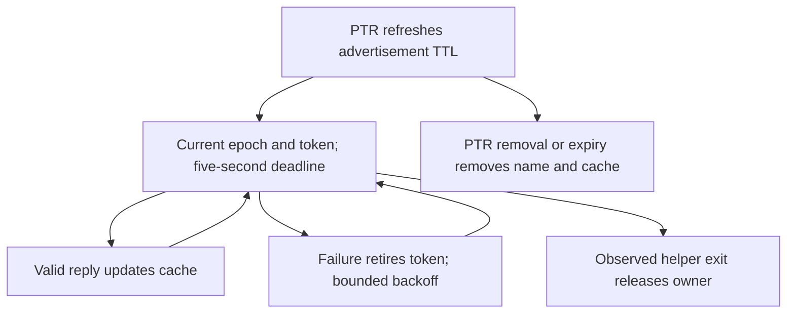

# Discovery

This page describes fork `main` at **`8989b3609dd1294f4d1d6eb1502f345cc22bc382`**, reviewed on 2026-10-12, including original stable `cf420d97700463c56adc31408510e8336e99e51c`. Final Group D `277efc5` is pushed and integrated here, not merged upstream. [Audit](audit.md) and [D acceptance](../issues/GROUP-D-ACCEPTANCE.md) bind results and historical failures to their sources.

The desktop uses Windows DNS-SD without Bonjour. Long-lived browse operations remain in the WPF process; production resolves run one query per bounded helper process because an ordinary resolve callback or successful Cancel return does not prove callback quiescence. [WindowsDiscovery](https://github.com/ThatMarko/AirFlash/blob/8989b3609dd1294f4d1d6eb1502f345cc22bc382/desktop/AirFlash.App/Services/WindowsDiscovery.cs) owns logical state, [NativeDnsServiceApi](https://github.com/ThatMarko/AirFlash/blob/8989b3609dd1294f4d1d6eb1502f345cc22bc382/desktop/AirFlash.App/Services/NativeDnsServiceApi.cs) owns native browse inputs, and [ResolveProcessDnsServiceApi](https://github.com/ThatMarko/AirFlash/blob/8989b3609dd1294f4d1d6eb1502f345cc22bc382/desktop/AirFlash.App/Services/ResolveProcessDnsServiceApi.cs) owns resolve-child lifetimes.

## When browsing starts

[AppViewModel.UpdateDiscoveryDemand](https://github.com/ThatMarko/AirFlash/blob/8989b3609dd1294f4d1d6eb1502f345cc22bc382/desktop/AirFlash.App/ViewModels/AppViewModel.cs#L198) requests browsing while the panel or Settings receiver page is visible, or during a ten-second startup search when automatic connection is enabled globally or for a non-hidden receiver. Hidden startup with no automatic intent can remain paused. Suspended discovery preserves its catalog and does not revoke playback.

Start checks DNS-SD availability, subscribes network notifications and arms one-second monotonic maintenance. Successful resolve refresh and adapter enumeration use twenty-second cadence. Production queues potentially blocking Start/Cancel off the dispatcher and outside publication frames.

## Which interface is queried

[NetworkAdapterCatalog](https://github.com/ThatMarko/AirFlash/blob/8989b3609dd1294f4d1d6eb1502f345cc22bc382/desktop/AirFlash.App/Services/NetworkAdapterCatalog.cs) retains unavailable non-loopback adapters to explain a saved pause. [DiscoveryInterface.ResolveIndex](https://github.com/ThatMarko/AirFlash/blob/8989b3609dd1294f4d1d6eb1502f345cc22bc382/desktop/AirFlash.Core/Receiver.cs) uses index 0 only for an empty selection. An up adapter with IPv4/nonzero index uses that index; a missing, down or address-less selection pauses without fallback.

Browse and helper resolve receive this index. It does not bind Rust playback egress. Media sockets follow the RTSP connection's local address; timing sockets retain their wildcard/routing boundaries in [Engine](engine.md). Settings display alone does not change live selection.

## The browse

The service types are `_airplay._tcp.local` and `_raop._tcp.local`. Start must remain pending (`9506`); unexpected non-pending results retire/retry the logical request and report diagnostics. Callbacks match exact owner and epoch. Native contexts are opaque never-reused tokens, not managed pointers.

Positive PTR expiry is monotonic time plus TTL, capped at 86,400 seconds. TTL zero removes the advertisement, cached record and exact pending logical request, then retires/cancels its owner. Browse errors retire/retry with backoff. Raw x64 parsing uses type offset 16, flags 20 and TTL 24; fixtures distinguish flags from TTL. Stale/unknown callbacks still free their returned DNS payloads. Observer/logging errors are isolated.

### Restart, suspension and epochs

General network notifications restart without identifying which adapter changed; twenty-second adapter checks restart on index changes. Restart retires owners, clears advertisements/pending requests, resets browsers and gives surviving cached records ten seconds for rediscovery. It schedules native work before any resulting publication: **it does not promise an unconditional empty Changed event before an inline new resolve**.

An explicit interface change clears records and publishes that transition. A selected unavailable interface starts no browser/helper. Stop suspends demand and clears advertisements/pending requests while keeping the catalog; Dispose clears all state. Old epochs and obsolete same-epoch tokens cannot publish stale data or clear newer requests.

## The resolve

Every initial/refresh request has a five-second monotonic logical deadline, including requests with no cached result. Timeout, failed Start, invalid/failing result, removal or expiry retires its exact token. Still-advertised names retry with exponential one-to-thirty-second backoff; repeated PTRs do not reset failures. Success resets failures and schedules refresh after twenty seconds.

[ResolveWire](https://github.com/ThatMarko/AirFlash/blob/8989b3609dd1294f4d1d6eb1502f345cc22bc382/desktop/AirFlash.App/Services/ResolveProcessDnsServiceApi.cs) validates one bounded UTF-8 JSON reply (65,536 bytes excluding newline), version/status consistency, matching instance/type, IPv4, port 1–65535, at most 256 TXT pairs and bounded strings. Native instance copying checks unsigned count/array shape, IPv4 pointer and port before freeing result memory. IPv6/hostname are not substituted.

Acceptance requires current advertisement, epoch, token and unexpired deadline. A copied reply completes logical resolution, **not resource ownership**.

## Native and process ownership

[DnsResolveHelper](https://github.com/ThatMarko/AirFlash/blob/8989b3609dd1294f4d1d6eb1502f345cc22bc382/desktop/AirFlash.App/Services/DnsResolveHelper.cs) dispatches before WPF, logging, settings, COM or engine extraction. It starts no descendants, emits only its first bounded result and has a six-second self-termination watchdog, including blocked native Start. It does not reclaim pending native resolve inputs on callback return; its address space ends instead.

The parent roots the exact process object before Start. Its global maximum of eight child owners includes unstarted, starting, cancelled and killed-but-unobserved children across instances/epochs. A throwing Start can still associate a process. Only proved absence of association permits pre-start settlement.

Once started, **only successfully observed exit of that exact child releases ownership**. Reply, deadline, Cancel or Kill alone is insufficient. Read/Kill failures can still settle if exit is confirmed. Failed exit observation retains capacity, reports uncertainty and retries observation; it never substitutes a PID. Parent read/process budgets and termination complement the helper watchdog and logical deadline.

Browse request/name/cancel inputs remain until documented terminal cancellation `ERROR_CANCELLED = 1223`, or proved non-pending admission, with native/managed callback frames ended. Cancel return is not settlement. Ordinary result payloads have their own freeing obligation. Cancellation from callbacks/publication is deferred and coalesced to avoid joining those stacks.

Coordinator caps are 64 retained owners per instance and two unresolved owners per name, including old epochs; the shared table caps 128. The eight-child process boundary lets completed queries reclaim capacity, unlike the rejected retained-input in-process prototype. Unsettled ownership may pause requests and require app restart. Bounds do not promise Windows callbacks arrive.

## Cache lifetime

| Concept | Current lifetime |
| --- | --- |
| Advertised name | Positive PTR TTL, capped at one day; zero TTL/expiry removes it |
| Cached resolved record | Current advertisement expiry; renewed PTR extends it |
| Resume/restart cache | Ten seconds until advertised/resolved again |
| Pending logical request | Five-second deadline and exact-token retirement |
| Resource owner | Browse terminal/frame completion or observed exact-child exit |

There is **no fixed ninety-second cached-record timeout in current main**. Cache eviction alone need not remove still-advertised knowledge.

The one-second tick checks advertisement/cache expiry, logical deadlines and retry schedules. This is scheduling resolution, not a hardware disappearance alarm. A failed network packet does not establish a lost Windows callback.

## Fields the resolve keeps

| Field | Consumer |
| --- | --- |
| `deviceid` or RAOP prefix before `@` | Physical catalog identity |
| RAOP suffix/AirPlay-first metadata | Name/address selection |
| `model`, otherwise `am` | Model |
| `tsid`, `gpn`, `igl` | Stereo id/name/leader |
| `pk` | Compatible-endpoint check; ordinal comparison |
| RAOP `cn` | Later playback codec list |
| Other TXT, including `gid` | Retained, not the stereo grouping key |

`Discovery resolved:` logs cache absence **or changed description**. Repetition can follow restart/expiry/removal or metadata change/reversion; it identifies no Wi-Fi scan, receiver reboot or transport health. [After discovery](after-discovery.md) and [Playback coupling](playback-coupling.md) keep availability separate from owned transport.

## Failures during browse

DNS-SD/adapter unavailability, failed admission/callback, timeout, cancellation/exit uncertainty and capacity pause report through `Failed` to the application notice. Notices do not independently mutate the map; publication carries availability. Manual rows come from settings and remain independent.

## Check mode

`--discovery-check` is a real eight-second DNS-only check, not executed by this documentation refresh. `--dns-resolve-helper-check` uses six actual child processes with synthetic responses/watchdog/cancellation and no DNS query. Its previous receipt remains bound to `dc521ae`; it is not relabeled as new-main live DNS. Diagnostic flags select isolated startup data; ordinary helpers dispatch even earlier.

## Source and verification scope

Current [DiscoveryLifecycleTests](https://github.com/ThatMarko/AirFlash/blob/8989b3609dd1294f4d1d6eb1502f345cc22bc382/desktop/AirFlash.Tests/DiscoveryLifecycleTests.cs), [NativeDnsOperationTests](https://github.com/ThatMarko/AirFlash/blob/8989b3609dd1294f4d1d6eb1502f345cc22bc382/desktop/AirFlash.Tests/NativeDnsOperationTests.cs) and [ResolveProcessTests](https://github.com/ThatMarko/AirFlash/blob/8989b3609dd1294f4d1d6eb1502f345cc22bc382/desktop/AirFlash.Tests/ResolveProcessTests.cs) inject DNS/clock/child boundaries, use real unmanaged fixture buffers and explicit gates, and cover missing/inline/late callbacks, deadline races, token/epoch replacement, failed Start/Cancel/Kill/exit wait, owner caps, one hundred finite attempts/scoped cycles, restart/dispose, PTR expiry and selected-adapter no-fallback.

The original intermittent `DisposeFromChangedSubscriberCannotCancelWhileHoldingPublicationLock` failure was a fake drainer joining its own callback. Both drainer schedules now use explicit signals/deferred fake cancellation. A later unchanged-runtime green was not its repair; the original log established no production deadlock. [D acceptance](../issues/GROUP-D-ACCEPTANCE.md) preserves the failed run, controlled diagnosis and mutations. Current normal CI passes 667 Core plus stability/bundle checks; packaged UI qualification is separate. No new live DNS/receiver/route/acoustic experiment ran here.

## Historical baseline and superseded lifetime conclusions

At [`41190e0`](https://github.com/Ding-Kyoma/AirFlash/blob/41190e0d13a63a714c08dffe73ababca1804875c/desktop/AirFlash.App/Services/WindowsDiscovery.cs#L83), a pending resolve had no deadline. Ninety-second cache expiry could remove its instance while leaving `_pending`; another PTR skipped resolving until completion/removal/restart cleared it. [Report 04](../issues/ISSUE-04-HIGH-dns-resolve-without-deadline-stalls-discovery.md) preserves that root cause.

## Historical in-process Group D implementation (48e7ab62; lifetime conclusions superseded)

Earlier D treated resolve callback completion as settlement. Review of Microsoft's [Resolve](https://learn.microsoft.com/en-us/windows/win32/api/windns/nf-windns-dnsserviceresolve) and [ResolveCancel](https://learn.microsoft.com/en-us/windows/win32/api/windns/nf-windns-dnsserviceresolvecancel) contracts did not establish quiescence. The old six-operation live DNS probe's zero-owner counters therefore establish no general safe resolve reclamation. Browse terminal status was separately corrected from 995 to documented 1223. The conservative retained-input prototype exhausted per-name capacity after two browse cycles and was rejected. Current production uses helpers. D acceptance retains old observations with the retracted lifetime conclusion explicit.

## Earlier Group B implementation (through 9e894ab)

B changed the publication consumer independently of D's resolver. Its dated fake retention evidence is in [B acceptance](../issues/GROUP-B-ACCEPTANCE.md); current behavior is the production narrative above.
