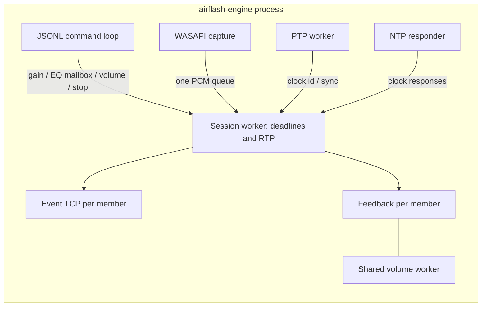

# Audio engine and the HomePod connection

## Current-source boundary — 2026-10-21

Current original stable is `439de626`. Its native terminal IPC/EQ results, application capture/standby and password support remain in combined `6c1e2ef`; remaining native changes preserve lookup errors and count local capture padding. The command process and worker retain distinct lifetimes. The current native tree matches previously qualified `6eabb186`; later desktop qualification is not a new native execution or real-receiver reliability result.

[Current source, acceptance and executed limits](../issues/PR-READINESS-2026-10-21.md) supersede older current/open/schema labels below. The remaining source links and test counts retain their recorded historical baselines; this documentation refresh claims no new test execution or upstream publication.

Source reviewed on 2026-10-12 at own-fork `main` `06237873dcb6394eb35e97a017c536843bd7743d`, containing original stable `cf420d97700463c56adc31408510e8336e99e51c`. This is the integrated fork runtime map. Groups E/F/H change authentication lookup, control results and capture accounting; original stable adds recording capture. The engine is no longer byte-identical to the original `41190e0` audit.

`airflash-engine` is a Windows console child. Stdout is JSONL v1; WPF owns process/session lifetime. One stored Running/worker owns playback/probe or persistent Pair at a time. Worker success/error leaves the command loop alive. Native expected errors are events, not a defined nonzero-exit taxonomy. See [Credentials and IPC](credentials-and-ipc.md).

## Source map

| Area | Production file |
| --- | --- |
| JSONL/worker/control result | [main.rs](https://github.com/ThatMarko/AirFlash/blob/06237873dcb6394eb35e97a017c536843bd7743d/native/airflash-engine/src/main.rs#L22) |
| Handshake, shared pull/fan-out, cleanup | [session.rs](https://github.com/ThatMarko/AirFlash/blob/06237873dcb6394eb35e97a017c536843bd7743d/native/airflash-engine/src/session.rs#L237) |
| RTSP/HAP connection | [rtsp.rs](https://github.com/ThatMarko/AirFlash/blob/06237873dcb6394eb35e97a017c536843bd7743d/native/airflash-engine/src/rtsp.rs#L89) |
| Pair setup/verify | [auth.rs](https://github.com/ThatMarko/AirFlash/blob/06237873dcb6394eb35e97a017c536843bd7743d/native/airflash-engine/src/auth.rs#L47) |
| Accessory-keyed current-user DPAPI | [credentials.rs](https://github.com/ThatMarko/AirFlash/blob/06237873dcb6394eb35e97a017c536843bd7743d/native/airflash-engine/src/credentials.rs#L106) |
| AirPlay/PTP clock | [clock.rs](https://github.com/ThatMarko/AirFlash/blob/06237873dcb6394eb35e97a017c536843bd7743d/native/airflash-engine/src/clock.rs#L14) |
| RTP/nonces/history/sync | [rtp.rs](https://github.com/ThatMarko/AirFlash/blob/06237873dcb6394eb35e97a017c536843bd7743d/native/airflash-engine/src/rtp.rs#L31) |
| Feedback/events/media/retransmits/schedule | [transport.rs](https://github.com/ThatMarko/AirFlash/blob/06237873dcb6394eb35e97a017c536843bd7743d/native/airflash-engine/src/transport.rs#L63) |
| Playback/recording capture/queue/padding | [live.rs](https://github.com/ThatMarko/AirFlash/blob/06237873dcb6394eb35e97a017c536843bd7743d/native/airflash-engine/src/live.rs#L78) |
| Prepared EQ/mailbox/crossfade | [equalizer.rs](https://github.com/ThatMarko/AirFlash/blob/06237873dcb6394eb35e97a017c536843bd7743d/native/airflash-engine/src/equalizer.rs#L77) |
| Receiver volume | [volume.rs](https://github.com/ThatMarko/AirFlash/blob/06237873dcb6394eb35e97a017c536843bd7743d/native/airflash-engine/src/volume.rs#L98) |

## Threads inside one playback

Native input bounds 65,536 bytes including newline; native output has no symmetric cap. Matching Stop cancels/joins; unmatched Stop still replies. EOF joins/exits. Valid replacement start/probe or parsed Pair drops/joins the previous worker; invalid replacement parameters leave it intact. Commands target stored session id, not proof of worker health. Full envelope/error details are in [Credentials and IPC](credentials-and-ipc.md).

## Validation before worker replacement

[ProbeOptions](https://github.com/ThatMarko/AirFlash/blob/06237873dcb6394eb35e97a017c536843bd7743d/native/airflash-engine/src/session.rs#L73) requires live start source loopback, duration zero, one/two distinct IPv4 peers/nonzero ports, 44,100/48,000 Hz, latency 0–2,000 ms, finite gain 0–1, valid EQ and ptp/ntp. Desktop uses ptp and can select a playback or recording endpoint through capture_endpoint. The wire source label remains loopback for either direction.

Finite probe is 1–5,000 ms, gain 0–0.1 and disabled EQ, with the same receiver/rate bounds. Start accepts qualification fields such as handshake_only, but desktop does not supply them. Pair parses Peer without start's IPv4/nonzero-port checks, opens no capture/PTP/NTP and does not use playback retry.

The finite `wav` source additionally requires [S16 stereo at the selected rate](https://github.com/ThatMarko/AirFlash/blob/06237873dcb6394eb35e97a017c536843bd7743d/native/airflash-engine/src/session.rs#L468), no more than five seconds of samples, nonempty input and peak absolute sample ≤1,639 (approximately 0.05). It eagerly scales that sample array by the initial `options.gain`; the WAV send branch does not reread the gain atomic. Thus a later matching `set_gain` can be stored/acknowledged without changing that WAV array. Live loopback/recording pulls do consume the updated atomic. This inherited qualification boundary is separate from desktop production playback.

## Clocks started before TCP

A Clock anchors SystemTime once plus monotonic elapsed; subsequent wall-clock change does not alter it. NTP starts first on wildcard ephemeral IPv4, accepting only 32-byte peer datagrams with masked type 0x52 and replying header 80 d3 / original request timestamp / receive / send timestamps. PTP SETUP does not advertise that port; NTP SETUP does.

For ptp, [PtpMaster](https://github.com/ThatMarko/AirFlash/blob/06237873dcb6394eb35e97a017c536843bd7743d/native/airflash-engine/src/clock.rs#L96) binds wildcard UDP 319/320 before contacting peers. Either bind failure ends the attempt. Random clock id is masked to 63 bits. Sync/follow-up every 125 ms and announce initially/about every second are unicast to peers; valid peer delay requests receive replies. No measured receiver offset is applied, and send errors are ignored. Discovery NIC selection is not passed into these sockets; Windows chooses routing.

## Per-member handshake

Desktop sends leader first. Members share initial RTP timestamp/Clock but independently draw sequence, SSRC, session UUID and keys. Random uniqueness is not explicitly checked.

[Connection::connect](https://github.com/ThatMarko/AirFlash/blob/06237873dcb6394eb35e97a017c536843bd7743d/native/airflash-engine/src/rtsp.rs#L89) has a three-second connect budget, nonblocking TCP and NODELAY. Ordinary RTSP requests use separate four-second write/read budgets, not four seconds for the whole transaction. The chosen TCP local address supplies member UDP binds/timingPeerInfo; discovery adapter is not a connect bind policy.

### Info and authentication

Plaintext GET /info returns deviceID/model/sourceVersion; peer_info reports version without selecting behavior. [accessory lookup](https://github.com/ThatMarko/AirFlash/blob/06237873dcb6394eb35e97a017c536843bd7743d/native/airflash-engine/src/session.rs#L258) loads a nonempty string deviceID through the one-handle bounded DPAPI loader. Only initial file absence selects transient; storage failure aborts before authentication. Existing missing/empty/non-string deviceID skips lookup and still selects transient.

Saved credentials use pair-verify/X25519, identity/signature proof and X-Apple-HKP 3. Absent credentials use transient SRP/X-Apple-HKP 4 with fixed PIN 3939 and no storage. Failed verification never falls back. Persistent Pair is separate. [Authentication](auth.md) owns SRP/M5/M6/PV detail.

Control encrypts with HKDF-SHA512 Control-Salt write/read keys from SRP or X25519 respectively. Incoming bad tags end the path; failed socket writes additionally poison future writes. HAP records use little-endian two-byte length, 1–1,024 plaintext bytes and 16-byte tag.

Requests use AirPlay/550.10 and increasing CSeq; /pair- uses HTTP, other paths RTSP. Older-CSeq responses are discarded; present CSeq must match, absent accepted. Headers cap at 16 KiB, body at 1 MiB, duplicate headers and Transfer-Encoding are rejected. Partial data survives idle polls. These wire contracts were unchanged from the audited native parser.

### Session SETUP

[session setup](https://github.com/ThatMarko/AirFlash/blob/06237873dcb6394eb35e97a017c536843bd7743d/native/airflash-engine/src/session.rs#L298) sends a binary plist:

| Field | Value |
| --- | --- |
| Sender deviceID/macAddress | Fixed synthetic sender identity in production source |
| name/sessionUUID | AirFlash / newly generated per-member UUID |
| timingProtocol | Selected uppercase PTP/NTP |
| isMultiSelectAirPlay | true |
| groupContainsGroupLeader / senderSupportsRelay | false / false |
| groupUUID | Omitted by desktop; optional IPC group_id |
| PTP timingPeerInfo/List | New peer UUID, type zero, Clock id, local address and false clock-port override |
| NTP timingPort | Ephemeral responder port |

After the first successfully parsed SETUP response, session_started permits later best-effort TEARDOWN. Nonzero eventPort starts a separate encrypted TCP connection: events-write for local reads, events-read for writes. Its parser validates only final protocol token HTTP/1.0, HTTP/1.1 or RTSP/1.0, replies 200/optional CSeq/Audio-Latency zero and does not interpret request method/path/body. Parse/read/write/closure stores a member fault. PTP then sends SETPEERS with all peer/local addresses.

The first SETUP response must contain a valid nonzero `eventPort`; it is not an optional event channel. A missing/zero port or failure opening that channel aborts member setup after best-effort teardown of the already established session. Codec and discovery metadata supplied by desktop do not replace this runtime validation.

### Audio SETUP

[audio setup](https://github.com/ThatMarko/AirFlash/blob/06237873dcb6394eb35e97a017c536843bd7743d/native/airflash-engine/src/session.rs#L353) offers one type-96 stream, 352 frames/packet, selected rate, shared-key material and requested latency converted to samples. Codec is PCM if cn empty/contains zero; otherwise ALAC if it contains one; unsupported fails. ct is 1/2 and format bits distinguish 44,100/48,000 PCM/ALAC. streamConnectionID is member SSRC.

The response requires nonzero dataPort/controlPort. Audio uses dataPort; control UDP handles sync/retransmits. Positive receiver latencyMin up to ten seconds of samples sets retransmit/playout deadlines/retention; otherwise requested latency is estimated. It does not shift RTP or replace requested latency in PTP sync. Negotiated measured_latency_ms remains null: there is no acoustic measurement.

## Record, then capture

After all members finish SETUP, RECORD then FLUSH occur for each with current sequence/timestamp. handshake_only returns earlier, before RECORD/capture. [capture initialization](https://github.com/ThatMarko/AirFlash/blob/06237873dcb6394eb35e97a017c536843bd7743d/native/airflash-engine/src/session.rs#L584) starts the single downstream capture queue only afterward, then waits at most 200 ms for its 20 ms target.

[capture selection](https://github.com/ThatMarko/AirFlash/blob/06237873dcb6394eb35e97a017c536843bd7743d/native/airflash-engine/src/live.rs#L241) prefers exact active device ids, then unique names across playback/recording; empty is default console Render. Render adds LOOPBACK; Recording does not. COM/capture is on its worker; shared engine period is preferred, fallback 20 ms; MMCSS is best effort.

Supported formats are float32 or 16/24/32-bit PCM, 1–8 channels, 8–192 kHz. Mono duplicates/only first two channels remain. Sinc resampling uses input-rate/100 chunks; queue target/cap is 20/60 ms with ±500 PPM local depth trim. Discontinuity resets input/resampler without flushing existing output. Silent/null input and absence are distinguished in [Capture and clocks](capture-clocks.md).

Capture initialization waits three seconds but joins on failure without a hard total deadline. Streaming is emitted after capture/fill/schedule/feedback/volume setup and before first media send. It means the loop is ready to send, not audible delivery. WPF uses it for state and conditional local mute.

## The send loop

[the loop](https://github.com/ThatMarko/AirFlash/blob/06237873dcb6394eb35e97a017c536843bd7743d/native/airflash-engine/src/session.rs#L625) drains member health/volume notices, waits for the monotonic deadline and recovers live ≥60 ms lateness by skipping slots, advancing sequence/RTP without nonce consumption, trimming stale capture and warning. Finite probe lateness fails qualification.

Every 100 ms, per-member control sync sends current RTP/AirPlay timestamp, requested latency offset and PTP clock id (PTP 0xd7; NTP 0xd4). The first marks extension. PTP does not pace the local Instant schedule.

One 352-frame pull pads absent **output-rate slots before EQ**, counting underrun once, saturating missing-frame/wholly padded-pull counters once before speaker fan-out. Captured silence/gain zero are not missing; EQ tails can make padded input nonzero. Raw source amplitude over 0.004 updates QPC onset before EQ/gain. EQ/master/clamp/S16 runs, then each member gets the same processed PCM before any services retransmits.

RTP uses big-endian header, encrypted PCM/ALAC, 16-byte tag and eight-byte little-endian counter suffix. PCM is S16 big-endian; ALAC converts/encodes little-endian. AAD is timestamp+SSRC; skipped schedule slots do not reuse/consume a nonce. History cap is 512 and max(one second, latency+250 ms) age; cached bytes can expire earlier at planned playout. Pending resends cap separately at 512.

Retransmit requests require peer IP (source port may differ); responses go to source socket address with exact cached ciphertext. Per call limits are one ms/16 requests/32 resends, independently per member. Missing/expired/over-cap requests count/dismiss. One failed local audio send warns/counts; twelve seconds without success faults. Local UDP success does not prove receiver delivery.

Capture/transport metrics approximately each second satisfy healthy desktop event reads. Final-loop metrics are emitted before cleanup; an early initialization failure may emit none.

### Equalizer and the two volumes

EQ mailbox preparation/replay/error results are in [Equalizer](equalizer.md). Mailbox adoption is not audio pickup/20 ms fade completion. Both stereo members receive the shared EQ PCM.

Live loopback/recording master gain is atomic float bits applied at each PCM pull; desktop output mute sets gain zero. Finite WAV instead uses its initially scaled array as described above. Receiver volume is independently queued/polled over RTSP: SET_PARAMETER mapping zero→−144 dB, percent 1–100→percent×0.3−30 dB. GET /info runs initially/after edits/about one second after each serial completed pass. Feedback shares that mutex, so slow transactions extend intervals. [Control and mute](control-and-mute.md) owns confirmation/time budgets.

## Watches that end the member

| Watch | Intermediate | Terminal |
| --- | --- | --- |
| Feedback | Two-second schedule; four-second delayed notice; 500/502/503/504 retry | Twelve-second transaction timeout; third transient status; 401/403 final auth; 454 retryable rejection; other statuses final |
| Events | Idle/incomplete allowed | Parser/read/write/protocol fault |
| Audio UDP | First local error warns/counts | Twelve seconds since local send success |
| Schedule | Live slot skipping/recovery | Finite qualification_late |
| Capture | Lack of event may pad | Actual capture/init/resampler/probe failure |

Feedback timers begin after mutex acquisition. Health retains first fault and at most 16 notices; media checks members in order. A warning/volume-read failure or single datagram failure is not automatically a whole-session terminal failure.

[Fault classification](https://github.com/ThatMarko/AirFlash/blob/06237873dcb6394eb35e97a017c536843bd7743d/native/airflash-engine/src/transport.rs#L63) maps cancel final, peer/read/write/reset/socket generally retryable, auth/protocol final; feedback has explicit status rules. Authentication protocol rewriting/storage classification is in [Failures](failures.md). Desktop retries only with permitted flag/force/budget/lifetime.

## Teardown

Normal-loop cleanup emits final metrics, drops/joins volume, then each member joins feedback, attempts TEARDOWN after successful first SETUP, and joins events. TEARDOWN has separate 300 ms write/read budgets with a fresh cancellation token; lock waits/joins are outside them. TCP drop shuts down both directions.

An error returned from the media loop is emitted by the worker wrapper after cleanup; successful finite completion or cancellation observed by the media loop emits `stopped`. Cancellation during earlier setup can instead return an error. The qualification `handshake_only` success emits `handshake_complete` and returns before the media-loop `stopped` path. Persistent Pair success emits `paired`, not the playback worker's terminal event. All these outcomes leave the command process and stored `Running` slot alive until replacement, matching Stop or EOF drops that slot. A failed join is ignored by the current [Running destructor](https://github.com/ThatMarko/AirFlash/blob/06237873dcb6394eb35e97a017c536843bd7743d/native/airflash-engine/src/main.rs#L48); no explicit worker-panic/liveness event is defined.

Desktop closes stdin/waits two seconds/requests kill/awaits exit; this is not a total two-second bound. Native stdout writes hold one process-wide lock and are synchronous, with write/flush errors ignored. A blocked pipe can delay a worker's event and cleanup even though it is separate from RTSP/media locks; existing fixtures do not establish a hard blocked-pipe shutdown bound.

## Persistent pairing

Pair opens one supplied TCP peer, reads /info and begins persistent SRP. After M2 it emits pin_required and waits up to 120 seconds with cancellation checks. Shared desktop normalizer removes permitted ASCII dashes and requires 4–8 digits; native strict validation remains. Successful M6 signature verification saves DPAPI and emits paired, without SETUP/PTP/capture. Stereo pairs each member separately; following playback is one process/two peers.

## What one pair shares

Capture/processed PCM, PTP clock id and initial RTP timestamp are shared. Each member has independent session UUID, sequence/SSRC, keys, control/events sockets, feedback and UDP. Desktop omits groupUUID, reports no group leader container and orders leader first for top-level volume events.

Either member's **terminal** health/send fault ends and tears down the complete worker. Individual transient response/send/volume failures can leave playback running. Current Group B retains this owned complete transport through missing/partial discovery; it does not falsely mark offline catalog rows online.

## Source verification and coverage

Native auth/credential, EQ/control, capture-padding, RTP, RTSP, continuity and volume fixtures verify observable contracts using temporary data, synthetic queues or localhost peers. Core fake connections and separate WPF mock harnesses cover desktop consumers. They do not prove full HomePod SETUP interoperability, actual PTP route/accuracy, WASAPI hardware behavior or acoustic output.

Executed suite/package evidence is centralized in [Verification](verification.md): [exact `0623787` normal CI](https://github.com/ThatMarko/AirFlash/actions/runs/38329156167) and the separate full package run at code-identical `4ae1db4`. Subsystem/group acceptance records retain earlier controls and source-specific results. This deeper review inspected source and regression assertions; it did not rerun suites or hardware checks.

## Historical audit

Original `41190e0` had render-only capture, Boolean existence lookup, misleading non-newer EQ replies and packet-only fill accounting. Stable recording support plus E/F/H change those specific boundaries; native auth crypto/RTSP/clock/RTP/feedback/receiver-volume source remains unchanged from that baseline. The [previous pinned page](https://github.com/ThatMarko/AirFlash/blob/8989b3609dd1294f4d1d6eb1502f345cc22bc382/docs/analysis/engine.md) preserves the complete original audit/links. Its byte-identical/feature-not-in-fork/pending reboot claims are historical.
