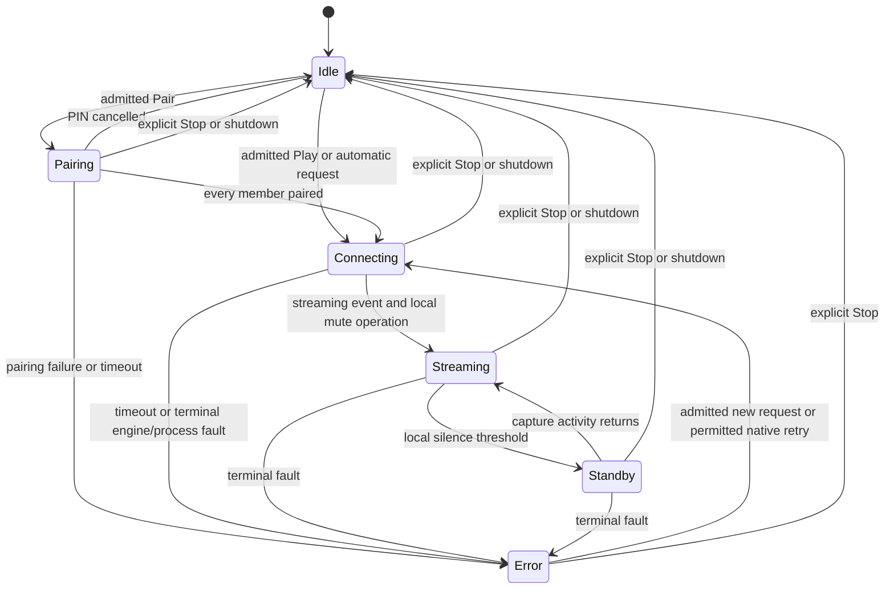

# Session control

## Desktop continuation — 2026-10-20

Since fork `5d43b04`, selecting StreamRate publishes its current Connecting snapshot, so dispatcher reference rejection cannot strand the application in Idle. Pairing owns one pending event reader throughout PIN/password input, retains it across valid submission, and cancels/joins the prompt on terminal events. The [current regression and desktop evidence](../issues/CURRENT-HEADLESS-IMPLEMENTATION-2026-10-20.md#desktop-continuation--2026-10-20) supersedes historical reader/publication limitations below; original stable remains `439de626`.


This page describes fork `main` at **`06237873dcb6394eb35e97a017c536843bd7743d`**, reviewed on 2026-10-12, including original stable `cf420d97700463c56adc31408510e8336e99e51c`. Final B/F/G/H changes are integrated and pushed. [SessionController](https://github.com/ThatMarko/AirFlash/blob/06237873dcb6394eb35e97a017c536843bd7743d/desktop/AirFlash.Core/SessionController.cs) owns desktop playback; [AppViewModel](https://github.com/ThatMarko/AirFlash/blob/06237873dcb6394eb35e97a017c536843bd7743d/desktop/AirFlash.App/ViewModels/AppViewModel.cs) coordinates callers. Rust remains a separate JSONL process. [Audit](audit.md) defines qualification limits.

## Doors into the controller

| Entry | Caller and admission |
| --- | --- |
| `TryStartExplicitAsync` | Play carries a synchronous explicit-intent token through persistence and serialization |
| `TryPairExplicitAsync` | Settings Pair carries that intent; no settings gate across PIN entry |
| `TryStartAutomaticAsync` | Dedicated automatic path validates owner, current intent and inactive state, including Error |
| `StopAsync` | Explicit Stop/shutdown invalidates older intent before serialization and cancels/joins actual work |
| `TryUpdateReceiverAsync` | Delayed discovery retarget validates owner/intent and complete online replacement under serialization |
| `TryRestartForEndpointAsync` | Default-loopback endpoint change requires captured owner/intent and active non-Pairing state |
| `UpdateSettingsAsync` | Saved Apply/panel edits; applicable signature restart or in-place gain/EQ/mute update |
| `TryRestoreAudioIfInactiveAsync` | Owned endpoint-return cleanup, without waiting for unfinished worker under serialization |

Public `StartAsync`/`PairAsync` create explicit intent then use those guarded paths. The remaining unconditional `UpdateReceiverAsync` is not the delayed discovery consumer. New offline/incomplete playback/pairing is rejected before engine creation. Manual/group routing is resolved by [ReceiverSelection](identity.md#explicit-playback-selection), not shared address.

`SessionCapture` atomically captures snapshot, desktop lifecycle owner (`_generation`) and intent (`_automaticIntent`) under the state lock. Owner identifies desktop start/stop/replacement, not receiver id, snapshot reference or engine UUID. Metrics publications and native retries retain it; same-id replacement changes it. Explicit Play/Pair/Stop and view-model/controller disposal invalidate old intent at entry before lifecycle waits. The shell's Quit handler awaits Settings/probe work before entering view-model disposal; that earlier interval has no equivalent admission barrier. Checks under `_serial`, including after cleanup awaits, prevent superseded actions from committing replacements. [Desktop shell](desktop-shell.md#shutdown-and-failure-boundaries) maps the complete shutdown caller.

Lifecycle/settings/gain operations use `_serial`; EQ uses `_equalizerWriter`; each connection serializes pipe writes. PIN workflows run in the worker rather than holding these lifecycle/settings gates. A fresh start awaits old cleanup. Rejection after cleanup publishes Idle instead of leaving a ghost active snapshot. [After discovery](after-discovery.md) explains settings/candidate stability through automatic admission and admitted-only bookkeeping.

## States



`IsActive` means Connecting, Pairing, Streaming or Standby. Passive discovery absence/incompleteness/restart does not leave those states. New automatic admission requires inactivity but permits Error. Retry exhaustion leaves Error. Snapshot includes receiver, message, capture metrics, target latency, diagnostics, stream rate and device volume.

Workers launch with `Task.Run`; hostname resolution runs asynchronously there. RTSP/capture execute in Rust; audio endpoint operations run on an MTA worker. UI awaits asynchronous controller work and yields. No claim of a hard UI-latency or cleanup deadline follows.

## The process

[ProcessEngineConnection](https://github.com/ThatMarko/AirFlash/blob/06237873dcb6394eb35e97a017c536843bd7743d/desktop/AirFlash.Core/EngineConnection.cs) opens hidden piped stdin/stdout/stderr. JSONL version remains 1. Native command input guards 65,536 bytes including newline; desktop stdout checks 65,536 UTF-16 characters after whole-line allocation. Sender/output limits are asymmetric; see [Credentials and IPC](credentials-and-ipc.md).

Commands have fresh request ids; playback attempts and each pairing process have fresh session UUIDs. Ordinary events filter by version/session rather than request id. [EngineEvents](https://github.com/ThatMarko/AirFlash/blob/06237873dcb6394eb35e97a017c536843bd7743d/desktop/AirFlash.Core/EngineEvents.cs) recognizes the exact defined process-owned version-1 empty-correlated terminal IPC rejection **before** normal session filtering, retaining original detail and nonretryable classification. Stale ordinary events remain filtered; malformed/non-object output becomes a controlled protocol failure. Nonfatal EQ errors do not terminate playback.

Cleanup sends Stop with a one-second send budget without waiting for its acknowledgement. Connection disposal closes stdin, waits two seconds, attempts process-tree termination if necessary, then awaits exit/stderr. These are budgets before escalation, not guaranteed total completion. Native worker Stop/failure and native command-loop exit are separate lifetimes; EOF cancels/joins owned work. Every retry creates a new process and session UUID, PTP clock and SSRCs, not RTP resume.

### Play command

Resolve each member to its first IPv4 answer, leader first, then send one `start` for the receiver:

```json
{
  "peers": [{ "host": "192.0.2.10", "port": 7000, "codecs": [0, 1] }],
  "source": "loopback",
  "duration_ms": 0,
  "latency_ms": 200,
  "gain": 0.4,
  "timing": "ptp",
  "capture_endpoint": null,
  "sample_rate": 44100,
  "equalizer": { "enabled": false, "preamp_db": 0, "band_gains_db": [0, 0, 0, 0, 0, 0, 0, 0, 0, 0] }
}
```

Gain is master volume/100, or zero for panel mute. Effective endpoint is null for default loopback or the selected endpoint id. Current stable supports playback/recording endpoint capture; JSONL source/endpoint selection remains compatible and actual native device direction is authoritative. Latency is effective per-receiver/global realtime 120, normal 200, buffered 500 or custom 0–2000 ms. Sample rate is validated 44.1/48 kHz.

The forty-second connect deadline is created after resolution/process creation, before waiting for the EQ writer and sending Start. Time spent in those waits consumes its remaining read allowance, but the deadline does not cancel a blocked writer or Start send: those receive the lifecycle cancellation token. It therefore bounds subsequent reads, not total startup. After Streaming each matching-event read has fifteen seconds. A quiet fake therefore eventually times out, while production metrics normally keep events arriving. Filtered unrelated events do not reset that same read budget.

| Event | Consumer |
| --- | --- |
| `streaming` | Local mute when enabled, then Streaming/uptime; duplicate event runs that handler again |
| Terminal `error`, unexpected `stopped`, EOF/protocol failure | Attempt fault, cleanup and applicable retry |
| `capture_metrics` after Streaming | Optional latency/queue/underrun/drop/padded-frame/whole-padded-packet data; Standby evaluation |
| `transport_metrics`/`warning` after Streaming | Live transport/warning update keyed by host/channel |
| `device_volume` after Streaming from leader | Runtime receiver slider/confirmation |
| Matching-sequence `equalizer_changed`/`equalizer_error` | Editor feedback; error remains nonfatal |

### Pairing command

Pair opens a process per member, leader first, sends `pair`, and gives each event read a fresh forty-second budget; there is no aggregate forty-second pairing deadline. PIN waiting is separate, with a desktop linked 120-second token and native 120-second wait/cancellation polls. PIN prompt follows accessory M2, before SRP proof. Dialog cancel/blank returns Idle without Start; token timeout can become Error. The one ASCII normalizer strips permitted dashes and sends 4–8 ASCII digits; [Authentication](auth.md) documents editing/submission/cancellation.

`paired` advances; a terminal error fails. After all members, their processes finish cleanup and one playback process starts the entire receiver. Credentials remain accessory `/info deviceID` keyed, never catalog/manual keyed.

## Local behavior around the stream

Mute-while-streaming defaults on. [Owned recovery](control-and-mute.md) initializes outside settings/lifecycle locks; unresolved obligations block new attempts that enable local muting, including retries. Disabled muting permits playback without discarding obligations. Actual opened recording endpoints never read/write mute or create journal ownership. Playback endpoints record exact prior true/false before mutation; normal restore follows worker/process cleanup and remains best effort.

Endpoint-return recovery captures owner/intent before enumeration. Active owned non-Pairing default-loopback changes can restart; inactive recovery serializes safely. An unfinished worker is awaited outside `_serial`, then owner/intent/inactive/disposal are rechecked before restoration; deferred failure reaches the notice. A newer lifecycle cannot be touched by stale endpoint work.

Standby defaults off, uses local capture QPC activity or uptime when absent, threshold 5–300 seconds (default 10, receiver override allowed). Standby changes the desktop state, not the native worker lifetime.

Device volume is independent runtime state, available only after engine reporting; edits debounce 200 ms with sequence and three-second pending confirmation. Reconnect clears volume state. Master volume debounces/persists after 200 ms and normally changes gain without restart. EQ preview coalesces about fifty milliseconds, retains editor ownership and sequence, and updates wire preparation without claiming DSP completion. See [Equalizer](equalizer.md).

## Replacing the process

Effective peer address/port/group-leader flags, capture endpoint, latency or sample rate change the restart signature. Names, ids, codec lists and member ordering alone do not. Same-owner identity promotion preserves the engine when the full signature is unchanged; migrated latency can legitimately restart. Pairing metadata updates do not restart Pairing. Passive missing/partial data cannot replace its complete transport.

Force reconnect defaults off. Structured retryable false prevents retry even when enabled; explicit true takes precedence over text. When retryability is absent, authentication/pairing/credential/signature/identity keywords make the fault final. Auth-phase network faults can remain retryable.

Streaming at least ten seconds resets the attempt budget before the next increment. Attempts respect configured maximum 1–20; delay doubles from one second to eight seconds. Lifetime cancellation returns before initiating/incrementing a later retry. Each admitted retry opens a fresh engine/session; desktop owner survives. Fresh start/restart clears diagnostic history. Native retry clears live metrics/transport/warnings, but preserves last fault and pre-fault capture/transport through successful retry. A further fault uses the last available snapshots.

## What the user sees in diagnostics

The dispatcher discards queued snapshots no longer equal to the current controller snapshot; this UI stale-display filter is separate from lifecycle authority. Monitor refreshes when visible, including new optional padding counters and existing transport/member/fault data. Copy diagnostics uses the existing serializer. Native counters reset per worker; reconnect count belongs to the desktop loop. An unavailable field is not zero. See [Capture and clocks](capture-clocks.md).

## Source verification and coverage

Current [SessionLifecycleTests](https://github.com/ThatMarko/AirFlash/blob/06237873dcb6394eb35e97a017c536843bd7743d/desktop/AirFlash.Tests/SessionLifecycleTests.cs), [SessionTests](https://github.com/ThatMarko/AirFlash/blob/06237873dcb6394eb35e97a017c536843bd7743d/desktop/AirFlash.Tests/SessionTests.cs) and WPF [UiSessionLifecycle](https://github.com/ThatMarko/AirFlash/blob/06237873dcb6394eb35e97a017c536843bd7743d/desktop/AirFlash.App/Verification/UiSessionLifecycle.cs) verify serialized authority/intent, post-cleanup rejection, retries, exact fake mute restoration, accessible Stop, endpoint recovery, Pair, process-owned IPC faults and retained diagnostics. Current main passes 667 Core; packaged synthetic UI/DPI qualification and hosted native tests remain source-bound in [acceptance](../issues/CONTINUATION-ACCEPTANCE.md).

The inherited EQ rollback fixture's old quiet fake could time out before its gain assertion. A controlled unchanged-runtime deadline proves that mechanism; the original CI cause remains inferred because no state was captured. The healthy fixture now gates actual sends/cancellation while preserving a live stream, and an independent finite-deadline fixture proves retained preview enters the next Start without touching a disposed transport. F changed tests/comment, not production deadlines or debounce.

## Implemented Group B behavior

At [historical `41190e0`](https://github.com/Ding-Kyoma/AirFlash/blob/41190e0d13a63a714c08dffe73ababca1804875c/desktop/AirFlash.App/ViewModels/AppViewModel.cs#L211), passive loss called unconditional Stop and automatic starts reused Toggle. Original stable `cf420d9` now includes [PR #19](https://github.com/Ding-Kyoma/AirFlash/pull/19)'s bounded retention/fresh-snapshot/Pairing changes; atomic ownership/admission remains additional fork scope. Final B `442e8d8` is integrated here; old PR #15 remains closed at its older snapshot. Original defects and decisive baseline observations remain in [B acceptance](../issues/GROUP-B-ACCEPTANCE.md). Earlier pre-reboot/unimplemented statements describe dated history, not current main. This document pass runs no real engine playback, endpoints or receivers.
