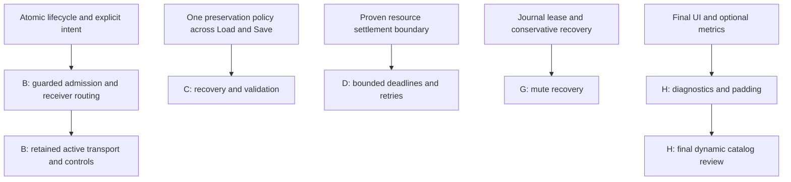

# AirFlash completed implementation and publication plan

## Current fork Main — 2026-10-12

All 17 reports in eight coherent groups are implemented, independently reviewed and integrated into reviewed fork runtime baseline `8989b3609dd1294f4d1d6eb1502f345cc22bc382`. Later documentation-only commits may advance Main without changing those runtime trees. All 10 implementation heads are ancestors of Main; complete desktop/native/scripts/installer/tests/workflow trees match qualified code `4ae1db4f01dcf7857482dd136ea8d9dffa3aa8a1`. Original stable is `cf420d97700463c56adc31408510e8336e99e51c`, already contained. [Backlog](README.md)/[combined acceptance](CONTINUATION-ACCEPTANCE.md) identify source, receipts, full group heads and executed limits.

This page describes **the implemented contracts and remaining publication work**, not unimplemented instructions. Original audited runtime `41190e0` remains the baseline for defective-source comparisons in reports. Excluded dev `67435a4` is not imported. Current source must be checked before further changes; an original defect is not presumed to remain in upstream or fork Main.

| Group | Reports | Integrated head | Status / acceptance |
| --- | --- | --- | --- |
| A | 05 | `de13b6d` | [Preflight report](ISSUE-05-MEDIUM-build-pipeline-missing-dotnet-sdk-check.md); upstream PR #11 merged |
| B | 01,02,03,10,11 | `442e8d8` | [B acceptance](GROUP-B-ACCEPTANCE.md); upstream PR #15 closed/unmerged; issue #14 open; PR #19 partial overlap merged |
| C | 06,07 | `5d72da3` | [C acceptance](GROUP-C-ACCEPTANCE.md); fork implementation |
| D | 04 | `277efc5` | [D acceptance](GROUP-D-ACCEPTANCE.md); fork implementation |
| E | 08,09 | `0ebc59b` | [E acceptance](GROUP-E-ACCEPTANCE.md); fork implementation |
| F | 12,14 | `421e1ea` | [F acceptance](GROUP-F-ACCEPTANCE.md); fork implementation |
| G | 13 | `96b9120` | [G acceptance](GROUP-G-ACCEPTANCE.md); fork implementation |
| H | 15,16,17 | `6855dfe` | [H acceptance](GROUP-H-ACCEPTANCE.md); fork implementation |
| Scrolling | Separate | `54cd18e` | [Acceptance](SETTINGS-SCROLL-ACCEPTANCE.md); upstream PR #13 merged |
| Installer | Separate | `a20f9db` | [Acceptance](INSTALLER-REFRESH-ACCEPTANCE.md); fork implementation |

## PR groups and order

Prepare one focused PR per coherent group, with distinct internal report acceptance; do not create a PR per helper/test. Recommended next submission is B, reusing issue #14 accurately and reviewing merged PR #19 overlap. Then independent C/D/E may proceed with normally one/two review-ready PRs open. F/G/H overlap controller/UI/native consumers and must refresh against what actually merges. Installer repair remains its own submission.

Publication requires selected Task 3 authorization; documentation updates do not authorize new upstream issues/PRs, reopening B, upstream merges/releases or cleanup. Closed PR #15 retains its frozen `11c6046` snapshot; current B is a different reviewed feature head. Own-fork code pushes are not upstream integration.

### Dependencies and parallel work

Implemented internal contracts:



These are shared implementation contracts, not proof that one public group depends on an unmerged PR. A tooling fix is not a functional prerequisite for runtime groups. F/G/H integrate through B's ownership API in fork Main; publication must reconcile API overlap against actual stable, not merge private documentation Main into feature branches. Delegate independent investigation/tests/review with one owner per shared file.

## Branch and repository boundary

Private analysis/issues/planning stay in ThatMarko/AirFlash. Future public changes start from freshly verified Ding-Kyoma stable Main, using a clean existing or managed worktree and explicit base. Read private docs from the separate fork checkout. Never merge/cherry-pick fork documentation history into code branches.

Push implementation features only to origin; target original stable Main for PRs. Public issue/PR bodies describe behavior, source and actual tests directly without private report numbers/links. Inspect both final diff and **every outgoing commit**, even when private files were later removed. Register a created/worked PR immediately. Preserve branches and ignored receipts until cleanup is explicitly authorized.

## Current verification and maintenance setup

The reboot gate is satisfied. Selected local .NET 10.0.401 resolves desktop `10.0.100/latestFeature`; the same executable/working directory must be preflighted. Local Rust/MSVC/Windows SDK are unavailable; native compilation/testing is hosted. Python dependencies are locked.

Core xUnit references Core, not WPF. Controller/settings go there; actual dispatcher/dialog/bindings use isolated `--ui-smoke`. Diagnostic startup chooses temporary data before logs/services; DNS helper dispatch precedes WPF/logging. Use save-entry signals, controlled asynchronous gates and finally release/join. Fixture source is not passing-test evidence.

Fresh Main passed 667 Release Core tests, 124 Python tests, lint and a build with zero warnings/errors; prior qualified code passed 667 Debug/Release. Exact Main CI 38296750592 is green. Exact code package 38294493405 passed 69 native (recording qualification/localhost soak ignored), six portable 1,059 each, three actual 125% DPI 40 each and disposable MSI lifecycle. See receipts rather than inferring totals from test inventory.

Appropriate maintenance commands, from root:

```powershell
# Wrapper enters desktop/; project paths are relative to desktop/.
./scripts/dotnet.ps1 build AirFlash.sln '-p:RestoreLockedMode=true'
./scripts/dotnet.ps1 test AirFlash.Tests/AirFlash.Tests.csproj '-p:RestoreLockedMode=true'
# Built fake-service WPF harness; output must be isolated.
$verificationFolder = Join-Path $env:TEMP ("airflash-verification-" + [Guid]::NewGuid().ToString("N"))
./scripts/dotnet.ps1 run --project AirFlash.App/AirFlash.App.csproj '-p:AirFlashConsole=true' -- --ui-smoke --output "$verificationFolder/report.json"
# Only when owning source/tooling requires these and native prerequisites exist.
cargo test --manifest-path native/airflash-engine/Cargo.toml
uv run --locked pytest -q -ra
```

Run narrow owning fixtures first, then relevant suite/build/integration. Do not rerun unrelated checks merely to grow counts. Do not reproduce A through a real release workflow/build: use fake operations. Production release may reserve a version/clean output even with publish disabled. Manual release source is complete; release notes/reservation history need review before separate publication. Real-device probes require separate authorization, gain<=0.1, duration<=5 seconds; never hardware soak.

## Group A — build readiness

### ISSUE-05

[Report](ISSUE-05-MEDIUM-build-pipeline-missing-dotnet-sdk-check.md); [source/verification map](../analysis/source-check.md).

Implemented common selected-host context and SDK resolver preflight before avoidable reservation, cleanup, native work or publishing. Checkout/integration/PATH precedence is deliberate. Resolution uses actual intended desktop working directory and global.json roll-forward, including explicit installer -DotnetPath. Runtime-only preferred hosts produce actionable failure rather than silently changing selection; informational commands/argument forwarding/exit propagation remain intact.

Fake-host/operation fixtures assert selection, cwd, arguments, compatible roll-forward, diagnostics and zero reservation/deletion/cargo/publish on failure. Historical 37 focused prerequisite tests/eight actual resolution checks remain source-bound; current 124 Python suite includes them. A is already upstream.

## Group B — session ownership, selection and discovery retention

The implemented SessionCapture atomically contains snapshot, desktop lifecycle owner and automatic intent. Owner survives metrics/native retries and differs from receiver id, snapshot reference and engine UUID. Controller conditional mutation validates under serialization. Passive discovery Stop plumbing is removed; guarded valid retargeting remains.

### ISSUE-01

[Report](ISSUE-01-HIGH-stale-discovery-snapshot-controls-new-session.md); [catalog](../analysis/after-discovery.md), [session](../analysis/session.md), [coupling](../analysis/playback-coupling.md).

Lifecycle owner is captured before awaited identity save and revalidated for retargeting. Absent/changed old row, same-id replacement, metrics/save failure cannot affect newer session/settings/worker/diagnostics. Same-owner identity promotion remains valid; changed signature restarts once. Actual controller/save-gate/WPF assertions are recorded in B acceptance.

### ISSUE-02

[Report](ISSUE-02-HIGH-delayed-autoconnect-replaces-new-session.md); [selection](../analysis/after-discovery.md), [session](../analysis/session.md).

Automatic admission is distinct from explicit Toggle. Explicit Play/Pair/Stop/shutdown invalidate old intent before awaits; action token survives persistence/serialization/cleanup. After persistence, canonical candidate/online/completeness/visibility/options/engine readiness are revalidated under settings gate through admission. Owner/inactive/intent validate serialized; Error stays eligible. Only admitted attempts update attempted/last-used and admitted failure counts; rejection preserves valid save/newer suppression/notice.

Tests cover Pair/Streaming/Stop, controller wait, eligibility changing without owner change, queued requests, Idle/Error, save failure/retry and post-admission newer notice. Stop fixtures hold Pair before PIN or close modal prompt first; CanExecute alone does not prove accessible normal Stop.

### ISSUE-10

[Report](ISSUE-10-MEDIUM-attempted-preferred-receiver-blocks-autoconnect.md); [selection](../analysis/after-discovery.md).

Attempted ids are filtered before ranking, so attempted preferred A cannot block unattempted B. Options/aliases/offline-incomplete reset/global reenable/suppression are preserved. Controlled fixtures assert one admitted B, all-attempted no-op and stale rejected requests consuming no candidate.

### ISSUE-11

[Report](ISSUE-11-MEDIUM-manual-play-redirected-to-stereo-by-address.md); [identity](../analysis/identity.md), [catalog](../analysis/after-discovery.md).

Manual rows retain exact endpoint/port/id/options, including shared addresses with complete/incomplete/hidden stereo groups. Explicit groups remain selected. Discovered members require unique confirmed canonical/alias ownership; ambiguity rejects and address-only fallback is omitted. Fake wire peers/preferences/last-used assert actual routing; accessory credential keys stay independent.

### ISSUE-03

[Report](ISSUE-03-HIGH-discovery-disconnects-active-playback.md); [coupling](../analysis/playback-coupling.md), [discovery](../analysis/discovery.md), [mute](../analysis/control-and-mute.md).

Owned Connecting/Pairing/Streaming/Standby survive passive missing/partial/repeated discovery, preserving full transport separately from unavailable catalog. Stop presentation remains accessible; no offline row is marked online and new offline/incomplete starts reject. Adapter browse restart retains owned attempt while DNS follows selected interface without fallback; selector is not an engine egress binding. Handshake/PIN/native faults, cancellation/retry/shutdown still govern the attempt. Bound Stop/reappearance/freshUUID/both mute-bit regressions remain executed.

## Group C — settings preservation and loaded validation

### ISSUE-06

[Report](ISSUE-06-MEDIUM-settings-recovery-reread-escapes.md); [settings](../analysis/settings.md).

Both startup Loads and later persistence share preservation state. Guarded capture/decode retains exact original bytes/BOM; catch never rereads unreadable input. Only genuine absence releases original-file concerns. Unreadable/uncertain originals cannot be overwritten by defaults. Pending revisions/backups/replacement remain retryable and notices describe actual state.

Locked/readable-invalid/BOM/access/backup/replacement/existing-backup/future-schema fixtures prove controlled preservation, not merely catching exceptions. C acceptance records decisive original 8 failures and later oversized-future-schema 6 failures.

### ISSUE-07

[Report](ISSUE-07-MEDIUM-invalid-loaded-settings-reach-runtime.md); [settings](../analysis/settings.md), [startup/catalog](../analysis/after-discovery.md).

Migration/documented normalization precede total shape/semantic validation, including null manual elements and invalid/null rates. Controlled recovery happens before runtime playback/mute/persistence consumption. Schema 1 migration/schema 2/extensions/nullable overrides/manual rows/offline adapter ids remain valid. WPF startup uses both actual Loads and verifies zero rejected-input playback/mute/unpreserved save. This is not arbitrary external-writer coordination after valid Load.

## Group D — DNS operation lifecycle

### ISSUE-04

[Report](ISSUE-04-HIGH-dns-resolve-without-deadline-stalls-discovery.md); [discovery](../analysis/discovery.md).

Logical advertisement/cache/pending/epoch/token/deadline/backoff are separate. Finite 5 second lookups and bounded retry reject stale tokens/epochs. Per-query helper roots owner before Start and globally caps eight unsettled children across instances/epochs; exact process-exit observation settles capacity. Reply/Cancel/Kill/deadline alone does not establish quiescence. Failed read/Kill can still settle on confirmed exit; failed wait retains owner until later successful observation.

Browse uses documented 1223 terminal cancellation with native/callback-frame deferral. Original intermittent test was fake self-join, corrected through controlled drainer winners and mutation assertions; later green alone was not repair. A permanent retained-native-owner prototype was rejected after normal repeated-query starvation. Current fake/process checks cover missing/inline/late callbacks, blocked/failed starts, timeout/retry/removal/restart/disposal/observer failures/caps/reuse; no live receiver incident is claimed.

## Group E — authentication input contracts

### ISSUE-08

[Report](ISSUE-08-MEDIUM-pairing-pin-format-mismatch.md); [auth](../analysis/auth.md), [pairing](../analysis/session.md).

Shared ASCII normalization removes permitted dashes then requires 4–8 digits for enablement/submission; native validation remains strict. Actual fake pair_pin payloads, typing/paste/selection/Unicode/boundaries/cancel are covered. Clipboard tests are explicitly disposable hosted with finally restoration.

### ISSUE-09

[Report](ISSUE-09-MEDIUM-credential-probe-errors-look-like-absence.md); [credentials/IPC](../analysis/credentials-and-ipc.md), [auth](../analysis/auth.md).

One opened handle preserves lookup/read errors; only initial NotFound means absence. Read-stage errors, DPAPI/parse/identity/verification failures remain errors and cannot switch methods. Current-user DPAPI/file format/accessory key remain. Synthetic temporary-root/injected faults test classification/bounds/tampering/replacement and one method; regression mutation is retained.

## Group F — JSONL error and preparation results

### ISSUE-12

[Report](ISSUE-12-MEDIUM-uncorrelated-ipc-errors-become-timeouts.md); [IPC](../analysis/credentials-and-ipc.md), [session](../analysis/session.md), [failures](../analysis/failures.md).

The narrowly defined process-owned v1 empty-correlated terminal IPC error is recognized before ordinary session filtering. Original detail and nonretryable classification survive playback, pairing and force reconnect. Stale ordinary events remain filtered and EQ feedback stays nonfatal. Receiver-free parser fixtures prove command-loop recovery separately from desktop attempt termination. Malformed/nonobject output becomes controlled protocol failure; general reader size and allocation policy remain unchanged.

### ISSUE-14

[Report](ISSUE-14-LOW-equalizer-ignored-update-success-metadata.md); [EQ](../analysis/equalizer.md), [IPC](../analysis/credentials-and-ipc.md).

Mailbox mutation returns an outcome plus retained sequence/preparation. Accepted and identical requests use compatible `equalizer_changed`; stale/conflicting requests use nonfatal `equalizer_error` without mutation. Full Prepared equality includes gain, bypass, coefficients and headroom. Replies and retained state are asserted together for 10/A, 9/B, 10/B, 10/A and 11/B, both rates, malformed input, session/probe/pair exclusions and subsequent recovery. Preparation adoption is not DSP completion. The inherited rollback fixture separately tests live-send cancellation and timeout/next-attempt preview without changing production timeouts.

## Group G — owned mute recovery

### ISSUE-13

[Report](ISSUE-13-MEDIUM-endpoint-mute-crash-recovery-gap.md); [mute/control](../analysis/control-and-mute.md), [session](../analysis/session.md).

The separate version-1 journal records actual endpoint id and exact prior bit using an exclusive file lease, owner GUID and generation. Durable Intent precedes mutation. Both original bits and meaningful interruption, COM/journal failure, lease, multiple-entry, disappearance/return and repeat paths are tested. A live known-restored persistence retry performs no further endpoint write; after restart ambiguity remains. Direction comes from the actual opened endpoint; recording acquires no new mute ownership and saved non-playback obligations remain Pending. Exact-id mismatch rejects before bit/journal access.

Recovery is modeless and runs outside audio/settings/lifecycle locks, with Stop accessible. When local muting is enabled, unresolved recovery blocks admission even for recording. Disabled muting permits operation without discarding recovery. Normal exact-bit cleanup remains best effort after journal failure, with no hard deadline or reconnect grace. Physical power-loss durability and later external endpoint changes remain unqualified.

## Group H — diagnostics and bounded observability

### ISSUE-15

[Report](ISSUE-15-LOW-unbound-copy-diagnostics-command.md); [settings](../analysis/settings.md), [diagnostics](../analysis/session.md).

The accessible localized Monitor action uses existing `CopyDiagnosticsCommand`, serializer and error surface. Production clipboard work remains on STA; a narrow injected writer supports isolated fixtures. Actual binding/copy/error/old-new metrics/Idle/Error/Streaming checks assert no engine, settings or audio mutation after joining the exact owned worker.

### ISSUE-16

[Report](ISSUE-16-LOW-capture-padding-metrics-lack-frame-accounting.md); [capture](../analysis/capture-clocks.md), [EQ](../analysis/equalizer.md), [diagnostics](../analysis/session.md).

Saturating UInt64 `padded_frames` counts substituted output-rate slots before EQ. `fully_padded_packets` counts pulls missing all 352 slots, once per shared pull before speaker fan-out. Existing underruns, captured silence, queue recovery and scheduling remain. Both rates, partial/whole padding, resumed capture, silence, EQ tails, reset and fault serialization are covered. Optional metrics treat invalid/missing as unavailable and preserve the unsigned range; pre-fault snapshots survive retry. No input-rate fill percentage or acoustic/network interpretation is claimed.

### ISSUE-17

[Report](ISSUE-17-LOW-orphaned-translation-keys-cleanup.md); [localization](../analysis/settings.md).

Final dynamic/literal/markup/preset and recording/Coffee consumer review removed only ten unused candidates from both Chinese catalogs. Labels, presets, formats and serialized fields remain. Six complete regional/catalog pairs and three actual fractional-DPI cases pass, with retained legacy/NoWrap negative controls. No test merely mirrors deleted keys.

## Maintenance and publication gates

1. Reverify actual upstream and remove already-fixed overlap before changes/publication.
2. Use controlled observable regressions and relevant owning build/integration; preserve failure receipts and provenance.
3. Preserve schema 2, JSONL v1, adapter no-fallback, manual persistence, authentication/accessory keys, exact mute bits, nonblocking dispatcher and additive metric compatibility.
4. Review final source/assertions independently and resolve concrete findings; a clean merge or green rerun alone is insufficient.
5. Exclude private docs from both outgoing history and final diff; update fork docs separately.
6. Distinguish fork implementation, upstream integration and real hardware qualification.
7. Preserve controls, branches and ignored evidence; cleanup, publication and releases remain separately authorized.

## Current implementation — stable refresh on 2026-10-11

Historical cross-link retained. The stable refresh and E–H completion led to qualified `4ae1db4`; current Main/results above replace earlier unimplemented, unpushed and reboot-pending stages.
